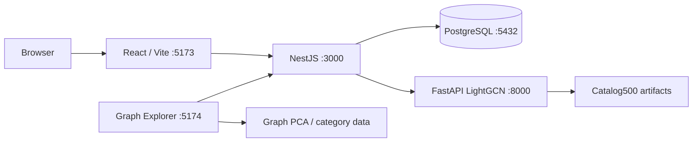

# Nexora — LightGCN Catalog500

Hệ thống thương mại điện tử tích hợp gợi ý sản phẩm bằng LightGCN, giải thích kết quả xếp hạng và trực quan hóa embedding 3D theo thời gian thực.

**Nhánh triển khai:** `feature/lightgcn-catalog500` · **Commit mốc:** `5ec5981`.

Hướng dẫn dành cho Ubuntu/Linux, chạy demo local trên một máy. Không cần huấn luyện lại AI. Không merge vào `main` và không seed thêm 753 sản phẩm Amazon vào catalog demo này.

## 1. Kiến trúc



| Thành phần | Địa chỉ local |
|---|---|
| Website | http://127.0.0.1:5173 |
| Backend | http://127.0.0.1:3000 |
| AI Serving | http://127.0.0.1:8000 |
| AI health | http://127.0.0.1:8000/health |
| Graph Explorer | http://127.0.0.1:5174 |
| PostgreSQL | 127.0.0.1:5432 |

## 2. Chuẩn bị

- Git, Docker Engine và Docker Compose v2, Node.js/npm, Python có hỗ trợ PyTorch (khuyến nghị Python 3.11 hoặc 3.12).
- Dùng phiên bản Node theo `engines` hoặc file cấu hình phiên bản của repo; nếu không có, thử Node 22 LTS bản cập nhật mới. Kiểm tra `node -v`, `npm -v`, `python3 --version`, `docker compose version`.
- Quyền truy cập repo GitHub `icurff/Nexora` và thư mục Google Drive do thành viên phụ trách cung cấp.

Tải các file sau vào `~/Downloads/Nexora_Backup/`:

| File | Nội dung |
|---|---|
| `lightgcn_catalog500.tar.gz` | Model, embedding, mapping, kết quả đánh giá (~100 MB) |
| `nexora_catalog500.dump` | PostgreSQL demo (~423 KB) |
| `nexora_images.tar.gz` | Ảnh catalog |
| `nexora_graph.tar.gz` | Dữ liệu Graph Explorer |
| `SHA256SUMS.txt` | Kiểm tra toàn vẹn |

Chỉ chia sẻ database và artifacts đã được phép chia sẻ, qua Drive giới hạn quyền. Không đưa mật khẩu, token, `.env`, dữ liệu cá nhân lên GitHub. Bản dump cần được kiểm tra hoặc làm sạch tài khoản và lịch sử cá nhân trước khi phân phối.

## 3. Lấy source code

Nếu chưa clone:

```bash
git clone -b feature/lightgcn-catalog500 https://github.com/icurff/Nexora.git
cd Nexora
```

Nếu đã clone, vào thư mục Nexora, kiểm tra thay đổi chưa commit rồi chạy:

```bash
git status
git fetch origin
git switch --track origin/feature/lightgcn-catalog500
```

Nếu nhánh local đã tồn tại, thay lệnh cuối bằng `git switch feature/lightgcn-catalog500` rồi `git pull --ff-only`.

Các lệnh tiếp theo chạy từ root của repo trừ khi có chỉ dẫn khác. Đặt biến ROOT trong mỗi terminal nếu dùng đường dẫn riêng:

```bash
ROOT="$PWD"
BACKUP="$HOME/Downloads/Nexora_Backup"
(cd "$BACKUP" && sha256sum -c SHA256SUMS.txt)
```

Chỉ tiếp tục nếu tất cả file đều OK.

## 4. Giải nén dữ liệu

```bash
mkdir -p ai/artifacts frontend/public ai/visualization/public
tar -xzf "$BACKUP/lightgcn_catalog500.tar.gz" -C ai/artifacts
tar -xzf "$BACKUP/nexora_images.tar.gz" -C frontend/public
tar -xzf "$BACKUP/nexora_graph.tar.gz" -C ai/visualization/public
```

Nếu đã có dữ liệu cùng tên, sao lưu trước khi giải nén để tránh ghi đè.

```text
ai/artifacts/lightgcn_catalog500/best.pt
ai/artifacts/lightgcn_catalog500/selected_user_embeddings.npy
ai/artifacts/lightgcn_catalog500/selected_item_embeddings.npy
ai/artifacts/lightgcn_catalog500/item_mapping.parquet
ai/artifacts/lightgcn_catalog500/selected_model_for_serving.json
ai/visualization/public/data/graph.json
ai/visualization/public/data/catalog500-categories.json
frontend/public/real-catalog/
```

## 5. Cấu hình môi trường

Kiểm tra các template và cấu hình thực tế trong nhánh:

```bash
find . -maxdepth 3 -type f \( -name '.env.example' -o -name '.env.sample' -o -name '*compose*.yml' -o -name '*compose*.yaml' -o -name 'requirements*.txt' \) -not -path '*/node_modules/*'
docker compose config --services
```

Tạo `.env` tại root và `backend/.env` từ template tương ứng nếu repo có template. Nếu không có, liên hệ người phụ trách để lấy danh sách biến môi trường **không chứa secret**. Không sao chép tài khoản/mật khẩu thật của người khác.

Các giá trị cần đồng bộ:

- Thông tin PostgreSQL trong Compose phải khớp `DATABASE_URL` của backend; backend chạy trên host nên dùng `127.0.0.1:5432`.
- Backend dùng `AI_SERVICE_URL=http://127.0.0.1:8000`.
- `NEXORA_SHARED_GRAPH=true` chỉ bật trong môi trường demo local có kiểm soát, không bật trên production.
- Cấu hình URL frontend, CORS, cookie và các secret khác theo template/source của repo. Dùng cùng hostname `127.0.0.1` cho website và Graph Explorer.

Tên biến còn lại và phiên bản dependencies chính xác cần đối chiếu với repo thực tế; tài liệu này không chứa secret hoặc tự giả định toàn bộ cấu hình.

## 6. Khởi động PostgreSQL và restore database

```bash
docker compose up -d postgres
docker compose ps
```

Nếu service không tên `postgres`, dùng tên từ `docker compose config --services`. Các lệnh dưới giả định container là `nexora-postgres-1`; thay nếu tên thực tế khác.

```bash
docker exec nexora-postgres-1 sh -c 'pg_isready -U "$POSTGRES_USER" -d "${POSTGRES_DB:-$POSTGRES_USER}"'
docker exec -i nexora-postgres-1 pg_restore -l < "$BACKUP/nexora_catalog500.dump"
```

**Chỉ restore vào database demo mới, rỗng.** Không restore đè lên database đang làm việc. Nếu đã có dữ liệu, tạo môi trường/database riêng và cấu hình lại URL trước khi tiếp tục. Không dùng `--clean`, `docker compose down -v` hay chạy seed bổ sung.

```bash
docker exec -i nexora-postgres-1 sh -c 'pg_restore --exit-on-error --single-transaction --no-owner --no-acl -U "$POSTGRES_USER" -d "${POSTGRES_DB:-$POSTGRES_USER}"' < "$BACKUP/nexora_catalog500.dump"
```

Kiểm tra catalog:

```bash
docker exec nexora-postgres-1 sh -c 'psql -U "$POSTGRES_USER" -d "${POSTGRES_DB:-$POSTGRES_USER}" -c "SELECT COUNT(*) AS products, COUNT(retailrocket_item_id) AS mapped, COUNT(DISTINCT retailrocket_item_id) AS unique_mapped FROM products;"'
```

Kỳ vọng: `500 | 500 | 500`. Bản dump đã chứa schema, không reset hoặc seed lại database.

## 7. Cài dependencies

Từ root, nếu repo sử dụng npm workspaces và có root lockfile, chạy `npm ci`. Với package độc lập (backend, frontend hoặc visualization), chạy `npm ci` trong thư mục đó nếu có `package-lock.json`; nếu không có lockfile thì `npm install`. Kiểm tra `package.json` trước khi chọn cách cài.

Tạo môi trường Python (không dùng đường dẫn venv của máy tác giả):

```bash
python3 -m venv .venv-ai
source .venv-ai/bin/activate
python -m pip install --upgrade pip
```

Ưu tiên requirements/lockfile thực tế của dự án nếu có. Nếu chưa có, bộ dependencies khởi đầu cho serving và export là:

```bash
python -m pip install fastapi uvicorn numpy pandas pyarrow scipy scikit-learn torch
```

Kiểm tra import và lỗi runtime; đây là danh sách khởi đầu, chưa phải lockfile đã kiểm chứng trên máy mới. Nếu backend cần Prisma Client, chạy `npx prisma generate` trong `backend/` theo schema/config của repo; không chạy `prisma migrate reset`.

## 8. Chạy hệ thống (4 terminal)

Mỗi terminal mở tại root Nexora. PostgreSQL đã chạy ở bước 6.

### Terminal 1 — AI Serving

```bash
source .venv-ai/bin/activate
./ai/scripts/run_catalog500.sh
```

Không chạy uvicorn thiếu `NEXORA_MODEL_DIR`, vì mặc định có thể tải model cũ `lightgcn_v2`.

### Terminal 2 — Backend

```bash
cd backend
npm run build && node --env-file=.env dist/main.js
```

### Terminal 3 — Frontend

```bash
cd frontend
npm run dev -- --host 127.0.0.1
```

### Terminal 4 — Visualization

```bash
cd ai/visualization
npm run build
npm run dev -- --host 127.0.0.1 --port 5174 --strictPort
```

Nếu port đã bị chiếm, kiểm tra tiến trình và dừng đúng dịch vụ cũ trước khi chạy. Giữ các terminal mở trong suốt demo.

## 9. Kiểm tra sau triển khai

```bash
curl -fsS http://127.0.0.1:8000/health | python3 -m json.tool
ss -lntp | grep -E ':(3000|5173|5174|8000|5432)\b'
```

Health phải trả `model_loaded: true`, `model_directory: lightgcn_catalog500`, `users: 108729`, `items: 500`, `embedding_dim: 128`, `run_id: catalog500_C_weighted128_cc481ffd50a5`.

Policy: history length 3, recency decay 0.75, cold alpha 0.8, warm alpha 1.0.

Nếu cần tái tạo dữ liệu graph (không train lại), chạy từ root với venv AI:

```bash
python ai/visualization/scripts/export_data.py --help
```

Kiểm tra tham số model directory theo trợ giúp/source, chọn đúng Catalog500 rồi chạy exporter. Sau đó chạy `python ai/visualization/scripts/export_catalog_categories.py` khi PostgreSQL đã restore. Không dùng graph từ model v2.

## 10. Kịch bản demo

1. Mở website và Graph Explorer, xem Training Graph: 1.000 user mẫu + 500 item, PCA từ embedding 128D xuống 3D.
2. Chuyển Category/Popularity để khảo sát danh mục và độ phổ biến; chọn một item, bật Top-K Similar, Focus và Hide unrelated. Top-K dùng cosine 128D, không phải danh sách ranking API.
3. Chọn LIVE cold-start, bắt đầu theo dõi, xem 3 sản phẩm trên website. Quan sát node phiên và quỹ đạo cập nhật. Nhãn AI vector biểu thị vector inference; VIEW-only là vector dự phòng từ lượt xem.
4. Mở Explainable Ranking: đối với cold session có lịch sử/ngữ cảnh hợp lệ, điểm kết hợp session 0.8 và popularity 0.2 sau chuẩn hóa; không áp công thức này cho mọi chiến lược.
5. Mở cửa sổ ẩn danh, xem nhóm sản phẩm khác; kiểm tra Shared LIVE có phiên độc lập và không trộn lịch sử.

## 11. Thông tin mô hình

| Thuộc tính | Giá trị |
|---|---|
| Dữ liệu tương tác | RetailRocket |
| Model | LightGCN Weighted Sampling |
| User / Item | 108.729 / 500 |
| Embedding / layers | 128 / 2 |
| Cạnh train phân biệt | 126.559 |
| Best epoch | 40 |
| Tương tác | view=1, cart=3, transaction=5; log1p tổng trọng số |
| Danh mục demo | 23 |

Kết quả offline next-item tổng thể (15.757 trường hợp): Hybrid Recall@10 0.15377, NDCG@10 0.09217; Popularity Recall@10 0.09894, NDCG@10 0.05210. Với riêng cold user có lịch sử phiên (1.170 trường hợp), Hybrid Recall@10 0.77607, NDCG@10 0.55140. Không diễn giải kết quả nhóm nhỏ thành kết quả toàn bộ.

Hạn chế: 90,3% user chỉ có một item train; metadata Amazon là metadata demo được gán vào ID RetailRocket, không đảm bảo tương đồng ngữ nghĩa; PCA mất thông tin; chưa có baseline category-based trực tiếp; việc chọn catalog từ toàn bộ sự kiện có thể gây thiên lệch đánh giá. Kết quả chỉ áp dụng cho thiết lập thực nghiệm này.

## 12. Xử lý lỗi nhanh

| Hiện tượng | Kiểm tra |
|---|---|
| Health trả 20.000 item hoặc 64D | Dừng AI cũ, chạy lại script Catalog500 |
| Thiếu model/ảnh/graph | Kiểm tra SHA256 và đường dẫn giải nén |
| Database không đúng 500 item | Kiểm tra DB URL và bản dump; không seed thêm |
| Backend không kết nối AI | Kiểm tra AI_SERVICE_URL, port 8000 |
| Prisma Client chưa có | Generate theo cấu hình repo |
| LIVE không theo dõi được | Cùng hostname 127.0.0.1, CORS/cookie, backend tracking; bắt đầu phiên mới |
| Category không có màu | Kiểm tra catalog500-categories.json và run ID |
| Graph và API khác model | Kiểm tra run ID trong graph.json và /health |

## 13. Đồng bộ code

```bash
git switch feature/lightgcn-catalog500
git pull --ff-only
```

Source qua GitHub; model, DB, ảnh và graph qua Drive. Chỉ tải lại artifacts khi có phiên bản mới tương ứng. Không force-add thư mục ignored, không commit `.env`, không merge main khi chưa thống nhất với nhóm.

## 14. Trạng thái kiểm thử

Máy tác giả đã xác nhận model đúng qua `/health`, catalog mapping 500/500, kiểm chứng embedding/PCA Training Graph, triển khai graph analysis và commit source. Backup model/database đã có checksum; việc đóng gói ảnh/graph và push được tác giả báo đã hoàn thành. Kiểm chứng số học vector LIVE, kiểm thử nhiều phiên và triển khai sạch trên máy thành viên chưa có kết quả xác nhận đầy đủ. Hướng dẫn này cần được kiểm thử trên máy thành viên trước khi coi là release hoàn chỉnh.
