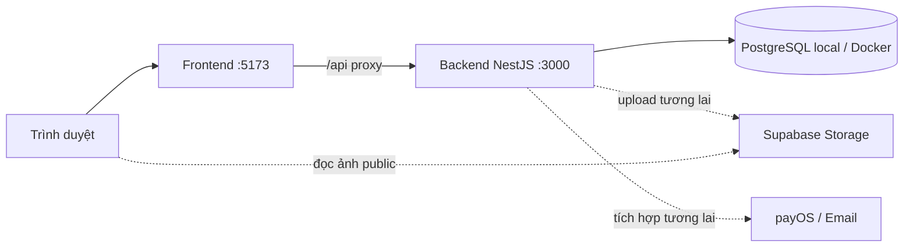

# Kiến trúc modular monolith — Nexora

| Thông tin           | Giá trị                                                                                     |
| ------------------- | ------------------------------------------------------------------------------------------- |
| Phiên bản           | 3.2                                                                                         |
| Cập nhật            | 01/11/2026                                                                                  |
| Kiến trúc           | Một frontend React/Vite, một backend NestJS, PostgreSQL local; Supabase Storage cho media |
| Tài liệu liên quan  | [BRD](BRD.md), [SRS](SRS.md), [Thiết kế database](DATABASE_DESIGN.md)                       |
| Kế hoạch triển khai | [Implementation tasks](IMPLEMENTATION_TASKS.md) — mã task, hiện trạng và điều kiện bàn giao |

## 1. Quyết định kiến trúc và hiện trạng

Nexora dùng modular monolith: các nghiệp vụ nằm trong cùng tiến trình NestJS và dùng chung database. Frontend gọi trực tiếp backend qua `/api/v1`; không có API gateway, gọi HTTP giữa các module, Saga hoặc Kafka. Cấu hình được tổ chức theo hai ứng dụng, PostgreSQL local và Supabase Storage bên ngoài.

| Thành phần  | Đã triển khai                                                                                               |
| ----------- | ----------------------------------------------------------------------------------------------------------- |
| Frontend    | React/Vite/TypeScript; Auth, Account address book và chọn địa chỉ checkout dùng API; danh sách/detail sản phẩm và giỏ Customer dùng API; checkout đặt hàng/orders chưa khả dụng, các trang catalog khác còn fixture |
| Backend     | NestJS, AuthModule address/profile/session APIs, CatalogModule public/admin Product/SKU/inventory APIs và OrderModule cart/COD checkout/order APIs; upload ảnh/video lên Supabase Storage; checkout integration chưa kiểm chứng |
| Auth        | Đăng ký Customer, login email/Google OAuth, refresh/logout/session, đổi/khôi phục mật khẩu, thu hồi phiên và CRUD sổ địa chỉ; OAuth callback cần Client ID/Secret và redirect URI cấu hình |
| Persistence | Prisma ORM/repositories và `schema.prisma`; PostgreSQL 17 local trong Compose, đồng bộ schema thủ công bằng `npm run db:push` |
| Docker      | Compose chạy frontend/backend/PostgreSQL local với named volume; Supabase Storage vẫn ở ngoài, không healthcheck |
| CI          | Kiểm tra và Docker build cho hai ứng dụng frontend/backend                                                  |

Category CRUD, Product/SKU, public catalog listing/detail, account cart, account address book, inventory APIs và upload media thuộc các module trong cùng backend. Auth lưu địa chỉ nhận hàng với tên tỉnh/xã dạng text; frontend lấy lựa chọn tỉnh/xã từ JSON tiếng Việt trên GitHub. Checkout chỉ đọc/chọn địa chỉ đã lưu; đặt hàng chưa khả dụng. Order cart MVP không giữ tồn, không dùng cart version/idempotency/event hay transaction nghiệp vụ; các thao tác đồng thời chưa được kiểm chứng. Schema chỉ được đồng bộ thủ công vào PostgreSQL local bằng `npm run db:push`; dự án không dùng migration workflow. Luồng trình duyệt end-to-end chưa được kiểm chứng. Storage upload trực tiếp đã smoke-test thành công; luồng upload nhiều ảnh/video qua Admin API và ghi metadata chưa được kiểm chứng end-to-end. Đơn hàng, thanh toán, email thông báo đơn, tracking và rule-based recommendation chưa được triển khai. Khôi phục mật khẩu gửi trực tiếp qua Gmail SMTP; task 015 về email job/worker/retry chưa triển khai. Task chi tiết và hiện trạng nằm trong [Implementation tasks](IMPLEMENTATION_TASKS.md#current-status); không tạo folder ứng dụng mới để làm những task này.

Mỗi Product tự cấu hình mã/nhãn lựa chọn SKU; Category chỉ phân loại. Cột `categories.option_config` cũ được giữ lại nhưng không còn dùng. Product dùng mô tả cho thông tin/thông số chung, không có Attributes riêng. Migration `5_product_sku_options` đã bổ sung cấu hình vào Product và backfill từ Category cũ.

Khoảng trống hiện tại: frontend lưu access token trong localStorage, khác mục tiêu bộ nhớ frontend ở NFR-02; Origin/CSRF, rate limit, request ID và chuẩn lỗi chung chưa hoàn chỉnh. Bucket `catalog-images` cần public-read; browser không có quyền upload trực tiếp. HTTP/guard tests hiện thay Auth/DB adapter, chưa chứng minh hành vi PostgreSQL/Storage/trình duyệt thực tế. Các cấu hình Compose/CI có sẵn chưa phải bằng chứng nghiệm thu startup/persistence hoặc pipeline từ xa.

## 2. Cấu trúc repository

```text
nexora/
├── frontend/                   # React + Vite; package/lockfile/Dockerfile riêng
│   ├── src/
│   └── vite.config.ts
├── backend/                    # Một ứng dụng NestJS
│   ├── src/
│   │   ├── auth/               # Controller/service, models, UserRepository/SessionRepository và guards
│   │   ├── database/           # PrismaService, cấu hình TLS, seed và CLI
│   │   ├── generated/prisma/   # Client sinh tự động, không commit
│   │   ├── app.module.ts
│   │   ├── configure-app.ts    # Prefix/validation dùng chung bootstrap và test
│   │   └── main.ts
│   ├── prisma/                # Prisma schema và seed
│   ├── prisma.config.ts       # Cấu hình Prisma CLI 7
│   ├── .env.example
│   ├── package.json
│   ├── package-lock.json
│   └── Dockerfile
├── docker-compose.yml
├── docs/
├── .github/workflows/ci.yml
├── .agents/skills/
└── AGENTS.md
```

Frontend tổ chức màn hình theo feature trong `frontend/src/features/`: `auth`, `account` (address book API/forms), `catalog`, `cart`, `wishlist`, `checkout`, `orders`, `content` và `admin`. Mỗi màn có file riêng trong `pages/`; `frontend/src/pages/` chỉ giữ route exports để `App.tsx` ánh xạ URL. Layout dùng chung nằm trong `layouts/`, API client và hooks Auth đang có vẫn thuộc feature Auth. Auth gọi API backend và hiển thị lỗi khi request thất bại. `catalog/demo-data.ts` cùng Zustand store thương mại cung cấp fixture/state cục bộ cho các màn chưa nối API; thao tác ở đó chưa ghi backend.

```text
frontend/src/
├── features/
│   ├── auth/{components,hooks,pages,services}/
│   ├── account/pages/
│   ├── catalog/{components,pages}/
│   ├── cart/pages/
│   ├── wishlist/pages/
│   ├── checkout/pages/
│   ├── orders/pages/
│   ├── content/pages/
│   └── admin/pages/
├── layouts/                  # Store and Admin shells
├── pages/                    # Route exports only
├── context/                  # Auth provider and local commerce store
└── App.tsx
```

Chỉ có hai thư mục ứng dụng. Các thư mục docs, docker và cấu hình công cụ vẫn phục vụ repository. Mỗi ứng dụng tự quản lý dependencies; chạy npm từ đúng thư mục, dùng Node 24/npm 11. Không dùng npm workspaces ở root.

## 3. Luồng request và phân quyền



Vite proxy `/api` tới `http://localhost:3000` khi chạy host, hoặc `http://backend:3000` trong Compose. Browser không cần biết DNS container. API Auth giữ nguyên `/api/v1/auth/...`. Không có endpoint /health hoặc Docker healthcheck; truy cập API/log ứng dụng để chẩn đoán kết nối. depends_on chỉ sắp thứ tự khởi động container, không kiểm chứng backend đã sẵn sàng.

AuthGuard xác minh access token và phiên/tài khoản còn hiệu lực trực tiếp qua AuthService. RolesGuard kiểm tra Customer/Admin ở route cần bảo vệ; mỗi nghiệp vụ kiểm tra quyền sở hữu. Không tin actor, role, giá, tồn hoặc trạng thái thanh toán từ browser. Module mới import AuthModule để dùng guard; không gọi endpoint introspection hoặc tin header danh tính. Endpoint introspection và internal service token đã được loại bỏ.

## 4. Ranh giới module

AuthModule, DatabaseModule, CatalogModule và OrderModule đã có. OrderModule xử lý cart và COD checkout; tạo các module Payment, Tracking hoặc Recommendation khi triển khai nghiệp vụ tương ứng, không tạo scaffold rỗng.

| Module dự kiến            | Trách nhiệm                                                          |
| ------------------------- | -------------------------------------------------------------------- |
| Auth                      | Tài khoản, phiên, hồ sơ, sổ địa chỉ nhận hàng dạng text, password reset                     |
| Catalog                   | Danh mục, Product/SKU, ảnh/Supabase Storage và tồn hiện tại; không lưu lịch sử biến động tồn |
| Order                     | Giỏ, COD checkout trực tiếp, tạo đơn, snapshot, vòng đời đơn và idempotency |
| Payment                   | payOS link/webhook và quy tắc COD; phối hợp Order trong cùng backend |
| Notification              | Email reset gửi trực tiếp qua Gmail SMTP; email đơn COD dùng outbox/worker retry; hộp thông báo Customer lưu PostgreSQL và đồng bộ SSE |
| Tracking / Recommendation | Event website, export không PII và gợi ý theo quy tắc khi triển khai |

Controller xử lý HTTP và DTO; service chứa nghiệp vụ; UserRepository/SessionRepository dùng Prisma Client để truy cập dữ liệu Auth. SQL khóa hàng tham số hóa nằm trong repository; service không chứa SQL. Provider ngoài có adapter riêng. Module giao tiếp bằng lời gọi provider trong tiến trình. Khi một use case cần nhiều module, truyền cùng Prisma.TransactionClient để tất cả ghi chung một transaction. Không import vòng hoặc tạo database/ứng dụng riêng cho từng module.

## 5. PostgreSQL local và Prisma ORM

Backend dùng Prisma Client/adapter-pg với PostgreSQL 17 trong Docker Compose. `backend/prisma/schema.prisma` là source of truth cho các bảng ứng dụng; không dùng Supabase PostgreSQL hoặc Supabase Data API cho dữ liệu nghiệp vụ. Supabase chỉ dùng cho object Storage. AuthModule/users/auth_sessions và JWT vẫn thuộc Nexora, không chuyển sang Supabase Auth.

Compose tạo service PostgreSQL `postgres`, port host mặc định 5432 và named volume `postgres_data`. URL trong root `.env`/Compose phải trỏ host `postgres`; URL trong `backend/.env` để chạy npm trên host phải trỏ `localhost`. Database local không bật SSL. Không in connection URL hoặc secrets trong log.

Khi schema thay đổi hoặc database local mới được khởi tạo, chạy thủ công `npm run db:push` trong thư mục backend. Lệnh này chỉ được trỏ tới PostgreSQL local rỗng/không có dữ liệu cần giữ; không chạy khi app khởi động, không trỏ tới Supabase hoặc database dùng chung. Prisma Migrate và các file migration không thuộc dự án. Không chạy lệnh xóa volume để xử lý lỗi.

Các module chia sẻ Prisma.TransactionClient; FK/JOIN chung hợp lệ và đơn giữ snapshot bất biến. Dữ liệu nghiệp vụ chỉ đi qua backend; không sử dụng Supabase Auth hoặc sửa bảng provider.

## 6. Transaction, retry và tích hợp ngoài

Các module tham gia một use case phải dùng cùng Prisma.TransactionClient; không mở transaction riêng hoặc tự commit trong provider lồng nhau. Checkout không có quote riêng: backend đối chiếu giá/quantity hiển thị, tự tính tổng và kiểm tra tồn khi đặt.

Checkout dùng một transaction ngắn: kiểm tra user/session/giỏ/giá/địa chỉ; khóa Product/SKU/inventory theo thứ tự ổn định; kiểm tra available; lưu đơn/snapshot; tăng reserved và ghi history/event; xóa đúng dòng giỏ; lưu kết quả idempotency rồi commit. Một dòng không hợp lệ khiến toàn bộ rollback. Gửi lại cùng key/payload trả cùng đơn; khác payload bị từ chối.

Lifecycle cập nhật đơn, reserved, history, business event và idempotency trong cùng transaction. Giữ `available = on_hand - reserved`, không âm tồn, thêm giỏ không giữ hàng. Kiểm tra chuyển trạng thái theo SRS. Hủy và hết hạn chỉ gây hiệu ứng một lần. Worker quét bù đơn hết hạn sau restart.

Không gọi network khi đang giữ khóa DB. Tạo payOS link cho đơn đã commit; lỗi link giữ đơn UNPAID, cho retry trên chính đơn. Webhook phải xác minh chữ ký/mã đơn/số tiền, sau đó khóa đơn và ghi PAID/event nguyên tử; webhook lặp không tạo hiệu ứng lặp. Browser return/cancel chỉ đọc trạng thái. Cạnh tranh payment/hủy dùng cùng khóa đơn và kiểm tra trạng thái mới nhất.

Email reset mật khẩu vẫn gửi trực tiếp sau khi commit token; provider lỗi thì xóa token vừa cấp để khách yêu cầu lại. Email đơn COD được ghi vào `email_outbox` cùng transaction tạo/đổi trạng thái, sau commit worker gửi Gmail SMTP, retry lỗi tạm thời và dọn SENT/FAILED sau 90 ngày. `user_notifications` được ghi cùng transaction; REST đọc theo đúng Customer và SSE chỉ báo cần đồng bộ. Realtime dùng bộ phát trong tiến trình hiện tại; PostgreSQL là dữ liệu bền vững khi reconnect. Không cần broker hoặc inbox giữa module. Email không đi vào dữ liệu tracking/export AI.

<a id="image-upload"></a>

## 7. Ảnh với Supabase Storage

Upload API/adapter thuộc Catalog đã có trong backend. Admin gửi multipart qua `/api/v1/admin/images` sau AuthGuard/RolesGuard; adapter dùng `SUPABASE_URL`, `SUPABASE_SECRET_KEY` và `SUPABASE_STORAGE_BUCKET`. Secret key hoặc service_role legacy chỉ ở backend, không VITE_* hoặc response/log. Supabase docs hiện yêu cầu key mới `sb_secret_*` gửi bằng `apikey` header; legacy JWT key dùng thêm `Authorization`.

Bucket `catalog-images` là bucket public dành media catalog; browser tải URL public trực tiếp qua HTTPS/CDN. Public read không cho phép ghi công khai: không mở policy upload/update/delete cho anon hoặc browser. Backend xác thực quyền Admin trước khi dùng server key. Không lưu PII/tài liệu riêng trong bucket này. Bucket cần cho phép JPEG/PNG/WebP tối đa 5 MiB và MP4/WebM/MOV tối đa 50 MB; code không tự sửa giới hạn bucket hoặc policy.

Catalog chỉ nhận MIME JPEG/PNG/WebP và MP4/WebM/QuickTime với giới hạn lần lượt 5 MiB và 50 MB, upload vào path riêng bất biến với `upsert:false`, rồi ghi metadata khi Storage trả thành công. Không xác minh chữ ký bytes, đọc lại object, tính SHA-256 hoặc dùng trạng thái READY. Nếu upload thành công nhưng lưu metadata lỗi, object có thể mồ côi; lần upload sau tạo path mới.

image_assets và product_images ở PostgreSQL local; bytes ở Supabase Storage, không trên server/volume ứng dụng hoặc bảng nghiệp vụ. Product/SKU liên kết asset đã có metadata sau upload thành công; ưu tiên ảnh SKU trước ảnh chung. Đơn giữ snapshot bucket/object_path/public URL. Gỡ liên kết không xóa object; dọn vật lý chỉ khi kiểm tra mọi tham chiếu và chặn liên kết mới đồng thời. Không trực tiếp sửa bảng storage.objects để thao tác file.

Mọi upload/provider request nằm ngoài transaction giữ khóa nghiệp vụ. Storage API và ghi metadata PostgreSQL là hai thao tác riêng; metadata chỉ được lưu sau phản hồi upload thành công. Backup DB không bao gồm bytes Storage: cần backup/restore riêng.

## 8. Chạy local và kiểm tra

### PostgreSQL local

PostgreSQL 17 chạy trong Compose với named volume để giữ dữ liệu qua lần restart. Root `.env` cấu hình container; Compose dùng hostname `postgres`. Chạy backend bằng npm trên host thì `backend/.env` dùng hostname `localhost`. Không cần Supabase Database, SSL CA hay migration files. Giữ signing secrets riêng; không gửi mật khẩu hoặc secret key qua chat/log.

Auth dùng PostgreSQL và signing secrets riêng của Nexora; không dùng Supabase Auth. Khôi phục mật khẩu cần `GMAIL_USER`, `GMAIL_APP_PASSWORD` và `FRONTEND_URL` (host gốc của frontend); backend tự thêm `/reset-password?token=...` vào liên kết email. Gmail App Password yêu cầu bật Xác minh 2 bước; lưu thông tin này chỉ trong backend `.env` hoặc secret của môi trường chạy. Cấu hình Compose ở root `.env`, chạy backend host ở `backend/.env`. AUTH_ACCESS_SECRET và AUTH_REFRESH_SECRET vẫn bắt buộc. Biến Supabase Storage chưa cần tới khi triển khai Catalog Storage. Xem [Implementation tasks](IMPLEMENTATION_TASKS.md#current-status).

### Docker Compose — frontend, backend và PostgreSQL

```powershell
docker compose config --quiet
docker compose up -d postgres
cd backend
npm run db:push
cd ..
docker compose up -d --build
docker compose logs -f backend
```

`db:push` đồng bộ Prisma schema vào database local và phải chạy thủ công sau khi xác nhận URL trỏ tới local PostgreSQL không có dữ liệu cần giữ. Lệnh không tự chạy khi app khởi động và không được dùng với Supabase/DB dùng chung. Frontend mặc định http://localhost:5173, backend http://localhost:3000; API dùng /api/v1. Không có healthcheck hoặc service_healthy; Compose `depends_on` chỉ sắp thứ tự khởi động.

Backend runtime dùng built JS, thay code cần docker compose up -d --build backend; frontend source có mount để Vite reload. Cấu hình mới dùng network mặc định của Compose. Không sử dụng thao tác xóa dữ liệu như một phần của cập nhật cấu hình.

### Chạy npm trên host

Dùng Node 24/npm 11. Sao chép backend/.env.example thành backend/.env khi chưa có; đặt DATABASE_URL trỏ tới PostgreSQL local trên `localhost` và cấu hình hai signing secret. Backend dùng Node loadEnvFile từ thư mục chạy; root .env chỉ được Compose nạp, không tự nạp cho npm trong backend.

```powershell
cd backend
npm ci
npm run db:push
npm run start:dev
```

Terminal khác từ root:

```powershell
cd frontend
npm ci
npm run dev
```

PostgreSQL cần chạy trước khi dùng npm trên host. Seed demo chỉ khi đã chủ động cấu hình ít nhất một cặp DEMO_CUSTOMER_EMAIL/PASSWORD hoặc DEMO_ADMIN_EMAIL/PASSWORD: npm run seed:demo. Mỗi loại tài khoản có thể seed độc lập; seed không ghi đè email đã tồn tại. Không tự seed database đang làm việc để test.

### Validation

Prisma Client được sinh khi npm ci/npm run build, hoặc chạy npm run prisma:generate sau khi sửa schema. Source sinh ở src/generated/prisma được bỏ qua bởi Git/ESLint và biên dịch vào dist. Docker build cần copy prisma/schema.prisma và prisma.config.ts trước npm ci. Prisma CLI vẫn dùng cho `db:push` và seed; Prisma Migrate không được dùng.

Backend/frontend: typecheck và lint. Các kiểm tra tĩnh không chứng minh tích hợp DB hoặc Storage thật; upload nhiều media qua Admin API vẫn cần kiểm tra riêng. Không chạy build/test suite/database test trừ khi task yêu cầu.

### Nguồn kỹ thuật

- [PostgreSQL Docker image](https://hub.docker.com/_/postgres): image PostgreSQL được dùng trong Compose.
- [Supabase Storage buckets](https://supabase.com/docs/guides/storage/buckets/fundamentals): public read và quyền ghi.
- [Supabase standard uploads](https://supabase.com/docs/guides/storage/uploads/standard-uploads): path mới/upsert và retry.
- [Supabase API keys](https://supabase.com/docs/guides/getting-started/api-keys): secret key chỉ dùng ở backend.

## 9. Phạm vi nghiên cứu và hạ tầng tương lai

Recommendation model Python/FastAPI vẫn là hướng tích hợp AI sau, ngoài hai ứng dụng hiện tại; chưa tạo folder/container/database. Rule-based recommendation và tracking của website sẽ được triển khai trong backend trước. Lỗi model/gợi ý không chặn mua hàng. Dataset RetailRocket, notebook và artifact nghiên cứu giữ nguyên.

Kafka, Redis và Elasticsearch không phải phụ thuộc hoặc yêu cầu của kiến trúc monolith hiện tại. Bổ sung search/cache/provider riêng khi một yêu cầu cụ thể cần; PostgreSQL luôn quyết định tồn và thanh toán. CD lên AWS chưa được triển khai.

## 10. Phiên bản cấu hình hiện tại

| Phiên bản | Ngày       | Thay đổi                                                                                                      |
| --------- | ---------- | ------------------------------------------------------------------------------------------------------------- |
| 2.3       | 27/10/2026 | Chuẩn hóa env root/backend, chỉ giữ cấu hình hai ứng dụng và Supabase; dọn tên biến/tài liệu đã được thay thế |
| 2.4       | 29/10/2026 | Bỏ biến Storage chưa sử dụng khỏi env mẫu/Compose; làm rõ DATABASE_URL dùng chung cho backend và migration |
| 2.5       | 29/10/2026 | Chuyển sang Prisma repositories/Migrate, baseline Auth cũ; mật khẩu tối thiểu 6 ký tự, giữ bcrypt và bỏ kiểm tra 72 byte |
| 2.6       | 29/10/2026 | Task 016 gửi email reset trực tiếp qua Resend; email_outbox/worker/retry của task 015 vẫn chưa triển khai |
| 2.7       | 29/10/2026 | Task 017 thêm UI reset mật khẩu; `/admin` kiểm tra quyền qua endpoint Admin-only                          |
| 2.8       | 29/10/2026 | Tổ chức màn UI theo feature; storefront và dữ liệu Admin dùng fixture cục bộ, chưa tích hợp API nghiệp vụ |
| 2.9       | 29/10/2026 | Chuyển gửi email đặt lại mật khẩu từ Resend sang Gmail SMTP qua Nodemailer                         |
| 3.1 | 01/11/2026 | Bỏ Attributes riêng của Product; giữ thông tin chung trong mô tả. |
| 3.4 | 01/11/2026 | Chuyển cấu hình SKU từ Category sang từng Product. |
