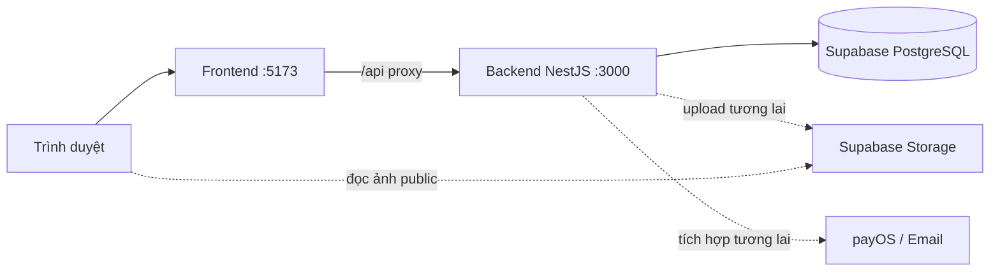

# Kiến trúc modular monolith — Nexora

| Thông tin           | Giá trị                                                                                     |
| ------------------- | ------------------------------------------------------------------------------------------- |
| Phiên bản           | 2.3                                                                                         |
| Cập nhật            | 27/10/2026                                                                                  |
| Kiến trúc           | Một frontend React/Vite, một backend NestJS, một database PostgreSQL trên Supabase          |
| Tài liệu liên quan  | [BRD](BRD.md), [SRS](SRS.md), [Thiết kế database](DATABASE_DESIGN.md)                       |
| Kế hoạch triển khai | [Implementation tasks](IMPLEMENTATION_TASKS.md) — mã task, hiện trạng và điều kiện bàn giao |

## 1. Quyết định kiến trúc và hiện trạng

Nexora dùng modular monolith: các nghiệp vụ nằm trong cùng tiến trình NestJS và dùng chung database. Frontend gọi trực tiếp backend qua `/api/v1`; không có API gateway, gọi HTTP giữa các module, Saga hoặc Kafka. Cấu hình được tổ chức theo hai ứng dụng và các tài nguyên Supabase bên ngoài.

| Thành phần  | Đã triển khai                                                                                               |
| ----------- | ----------------------------------------------------------------------------------------------------------- |
| Frontend    | React/Vite/TypeScript; đăng ký, đăng nhập, khôi phục phiên, đăng xuất, đổi mật khẩu                         |
| Backend     | NestJS, AuthModule, guard Customer/Admin, validation; không endpoint healthcheck                            |
| Auth        | Đăng ký Customer, login/refresh/logout/session, đổi mật khẩu và thu hồi phiên; JWT, refresh cookie HttpOnly |
| Persistence | TypeORM/PostgreSQL; migration users/auth_sessions và seed tài khoản demo                                    |
| Docker      | Chỉ frontend/backend; PostgreSQL và Storage dùng Supabase bên ngoài, không healthcheck                      |
| CI          | Kiểm tra và Docker build cho hai ứng dụng frontend/backend                                                  |

Catalog, giỏ/đơn hàng, thanh toán, email, tracking, rule-based recommendation và tích hợp Supabase Storage chưa được triển khai. Bảng/luồng bên dưới là thiết kế cho các bước tiếp theo, không phải chức năng hiện có. Task chi tiết và hiện trạng nằm trong [Implementation tasks](IMPLEMENTATION_TASKS.md#current-status); không tạo folder ứng dụng mới để làm những task này.

Khoảng trống hiện tại: frontend lưu access token trong localStorage, khác mục tiêu bộ nhớ frontend ở NFR-02; Origin/CSRF, rate limit, request ID và chuẩn lỗi chung chưa hoàn chỉnh. HTTP/guard tests hiện thay Auth/DB adapter, chưa chứng minh hành vi PostgreSQL/provider/trình duyệt thực tế. Các cấu hình Compose/CI có sẵn chưa phải bằng chứng nghiệm thu startup/persistence hoặc pipeline từ xa.

## 2. Cấu trúc repository

```text
nexora/
├── frontend/                   # React + Vite; package/lockfile/Dockerfile riêng
│   ├── src/
│   └── vite.config.ts
├── backend/                    # Một ứng dụng NestJS
│   ├── src/
│   │   ├── auth/               # AuthModule, controller, service và guards
│   │   ├── database/           # TypeORM, entities, migrations, seed và CLI
│   │   ├── app.module.ts
│   │   ├── configure-app.ts    # Prefix/validation dùng chung bootstrap và test
│   │   └── main.ts
│   ├── .env.example
│   ├── package.json
│   ├── package-lock.json
│   └── Dockerfile
├── docker-compose.yml
├── docs/
├── .github/workflows/ci.yml
├── .agents/skills/
└── AGENTS.md
```

Chỉ có hai thư mục ứng dụng. Các thư mục docs, docker và cấu hình công cụ vẫn phục vụ repository. Mỗi ứng dụng tự quản lý dependencies; chạy npm từ đúng thư mục, dùng Node 24/npm 11. Không dùng npm workspaces ở root.

## 3. Luồng request và phân quyền



Vite proxy `/api` tới `http://localhost:3000` khi chạy host, hoặc `http://backend:3000` trong Compose. Browser không cần biết DNS container. API Auth giữ nguyên `/api/v1/auth/...`. Không có endpoint /health hoặc Docker healthcheck; truy cập API/log ứng dụng để chẩn đoán kết nối. depends_on chỉ sắp thứ tự khởi động container, không kiểm chứng backend đã sẵn sàng.

AuthGuard xác minh access token và phiên/tài khoản còn hiệu lực trực tiếp qua AuthService. RolesGuard kiểm tra Customer/Admin ở route cần bảo vệ; mỗi nghiệp vụ kiểm tra quyền sở hữu. Không tin actor, role, giá, tồn hoặc trạng thái thanh toán từ browser. Module mới import AuthModule để dùng guard; không gọi endpoint introspection hoặc tin header danh tính. Endpoint introspection và internal service token đã được loại bỏ.

## 4. Ranh giới module

Chỉ AuthModule và DatabaseModule hiện có. Tạo module nghiệp vụ khi triển khai chức năng tương ứng, không tạo scaffold rỗng.

| Module dự kiến            | Trách nhiệm                                                          |
| ------------------------- | -------------------------------------------------------------------- |
| Auth                      | Tài khoản, phiên, hồ sơ, địa chỉ, password reset                     |
| Catalog                   | Danh mục, Product/SKU, ảnh/Supabase Storage, tồn kho và ledger       |
| Order                     | Giỏ, quote, tạo đơn, snapshot, vòng đời đơn và idempotency           |
| Payment                   | payOS link/webhook và quy tắc COD; phối hợp Order trong cùng backend |
| Notification              | Hàng đợi email bền vững và worker retry                              |
| Tracking / Recommendation | Event website, export không PII và gợi ý theo quy tắc khi triển khai |

Controller xử lý HTTP và DTO; provider chứa nghiệp vụ; adapter quản lý persistence/provider ngoài. Module giao tiếp bằng lời gọi provider trong tiến trình. Khi một use case cần nhiều module, truyền cùng EntityManager/transaction context để tất cả ghi chung một transaction. Không import vòng hoặc tạo database/ứng dụng riêng cho từng module.

## 5. Supabase PostgreSQL và dữ liệu hiện có

Backend kết nối trực tiếp PostgreSQL trên Supabase bằng TypeORM/pg, không dùng Supabase Data API cho nghiệp vụ. AuthModule/users/auth_sessions và JWT hiện có vẫn thuộc Nexora; không chuyển sang Supabase Auth hoặc sửa bảng auth.users/storage.objects của provider.

Cấu hình DATABASE_URL là PostgreSQL connection URI, không phải SUPABASE_URL HTTPS hoặc API key. Lấy host/port thực từ Dashboard > Connect; direct connection dùng cho backend/migration, Session pooler khi mạng chỉ hỗ trợ IPv4. Không đoán hostname hoặc dùng Transaction pooler cho runner migration hiện tại. Provision role ứng dụng có quyền schema/tables/sequences cần thiết; không chạy application bằng tài khoản administrator. Role chạy migration phải sở hữu/quản lý các bảng ứng dụng; quyền runtime tối thiểu cần được kiểm chứng ở task 002.

Kết nối luôn bật SSL và rejectUnauthorized:true. DATABASE_SSL_CA nhận PEM root certificate nếu chain chưa nằm trong CA mặc định của Node; hỗ trợ literal \n trong env. Bỏ các query parameter sslmode/sslcert/sslkey/sslrootcert khỏi DATABASE_URL vì chúng có thể ghi đè SSL object của pg. URL-encode ký tự đặc biệt trong mật khẩu. Database config không log connection string hoặc secret.

Compose chỉ mô tả hai ứng dụng. File .env ở root và backend/.env dùng DATABASE_URL, DATABASE_SSL_CA, SUPABASE_URL, SUPABASE_SECRET_KEY, SUPABASE_STORAGE_BUCKET cùng cấu hình Auth/port. Chỉ giữ các biến đang được dùng; không có biến cho gateway hoặc database local. Connection URL và Storage server key cần được người dùng điền từ project Supabase, không dùng hostname giả.

Dọn cấu hình repository không xóa tài khoản, phiên hoặc dữ liệu thật. Không tự dump/upload dữ liệu hay chạy migration lên project Supabase thật; xác định project đích và phạm vi dữ liệu trước thao tác. Task 002 kiểm chứng schema/role/permission, task 069 kiểm chứng backup/restore DB và Storage riêng.

Migration nằm ở backend/src/database/migrations, lịch sử vẫn là auth_schema_migrations. Giữ nguyên migration Auth đã áp dụng, không synchronize/reseed tự động. Trước khi migrate project đã có schema, kiểm tra xung đột và lịch sử; database mới chạy migration để tạo users/auth_sessions. Các module dùng cùng database/EntityManager; FK/JOIN chung hợp lệ và đơn vẫn giữ snapshot bất biến.

Dữ liệu nghiệp vụ chỉ đi qua backend. Tắt Data API nếu không dùng; nếu giữ bật, phải cấu hình grants/RLS để anon/authenticated không đọc/ghi bảng tài khoản/phiên và dữ liệu riêng. Nexora JWT không tự trở thành Supabase JWT. Quyền DB/Storage trên project phải được cấu hình và kiểm chứng riêng, chưa có bằng chứng kết nối Supabase thực trong repo.

## 6. Transaction, retry và tích hợp ngoài

Các module tham gia một use case phải dùng cùng EntityManager; không mở transaction riêng hoặc tự commit trong provider lồng nhau. Quote do server ký có TTL mặc định 15 phút theo Database mục 9.2; quote không giữ hàng và không giữ khóa giỏ qua request/UI. POST /orders trả đơn sau commit; retry sau timeout dùng cùng key/payload, không cần checkoutId/operationId phân tán.

Checkout tương lai dùng một transaction ngắn: kiểm tra user/session/giỏ/quote; khóa products/SKU theo thứ tự ổn định; kiểm tra available; lưu đơn/snapshot; tăng reserved và ghi ledger/history/event; xóa đúng dòng giỏ; lưu kết quả idempotency rồi commit. Một dòng không hợp lệ khiến toàn bộ rollback. Gửi lại cùng key/payload trả cùng đơn; khác payload bị từ chối.

Lifecycle cập nhật đơn, tồn, ledger, audit, business event và idempotency trong cùng transaction. Giữ `available = on_hand - reserved`, không âm tồn, thêm giỏ không giữ hàng. Kiểm tra chuyển trạng thái theo SRS. Hủy, hết hạn, ship và nhận lại chỉ gây hiệu ứng một lần. Worker quét bù đơn hết hạn sau restart.

Không gọi network khi đang giữ khóa DB. Tạo payOS link cho đơn đã commit; lỗi link giữ đơn UNPAID, cho retry trên chính đơn. Webhook phải xác minh chữ ký/mã đơn/số tiền, sau đó khóa đơn và ghi PAID/event nguyên tử; webhook lặp không tạo hiệu ứng lặp. Browser return/cancel chỉ đọc trạng thái. Cạnh tranh payment/hủy dùng cùng khóa đơn và kiểm tra trạng thái mới nhất.

Email dùng bảng email_outbox/job trong database chung, ghi cùng transaction nghiệp vụ rồi worker gửi sau commit với retry/backoff và khóa nhận việc. Không cần broker hoặc inbox giữa module. Tracking nghiệp vụ ghi event trong cùng transaction; email không đi vào dữ liệu export AI. Lỗi gửi email hoặc recommendation sau commit không làm mất đơn.

<a id="image-upload"></a>

## 7. Ảnh với Supabase Storage

Đây là thiết kế cho module Catalog chưa triển khai. Backend nhận upload từ Admin đã qua AuthGuard/RolesGuard; adapter Supabase Storage dùng SUPABASE_URL, SUPABASE_SECRET_KEY và SUPABASE_STORAGE_BUCKET. Secret key hoặc service_role legacy chỉ ở backend, không VITE_* hoặc response/log. Chưa thêm SDK/client upload cho đến khi thực hiện task 021–023.

Bucket catalog-images là bucket public dành riêng ảnh catalog; browser tải URL public trực tiếp qua HTTPS/CDN. Public read không cho phép ghi công khai: không mở policy upload/update/delete cho anon hoặc browser. Backend xác thực quyền Admin trước khi dùng server key. Không lưu PII/tài liệu riêng trong bucket này. Cấu hình bucket public, MIME JPEG/PNG/WebP và giới hạn 5 MiB phải được thiết lập trên project khi triển khai; chưa được tạo bởi code hiện tại.

Catalog kiểm tra bytes/MIME/kích thước ảnh bằng buffer/stream có giới hạn, ghi image_assets PENDING với bucket/object_path sinh trước upload. Upload dùng path riêng bất biến và upsert:false; thay ảnh tạo path mới, không ghi đè object đang có trong snapshot. Timeout giữ PENDING; đối soát object/path và SHA-256 bytes trước khi READY/retry. URL được dựng không tự chứng minh object tồn tại; xác minh metadata/nội dung cần thiết trước commit READY.

image_assets và product_images ở PostgreSQL Supabase; bytes ở Storage, không trên server/volume ứng dụng hoặc bảng nghiệp vụ. READY chỉ được gắn vào Product/SKU; ưu tiên ảnh SKU trước ảnh chung. Đơn giữ snapshot bucket/object_path/content_hash/public URL. Gỡ liên kết không xóa object; dọn vật lý chỉ khi kiểm tra mọi tham chiếu và chặn liên kết mới đồng thời. Không trực tiếp sửa bảng storage.objects để thao tác file.

Mọi upload/provider request nằm ngoài transaction giữ khóa nghiệp vụ. Storage API và transaction PostgreSQL là hai thao tác riêng dù cùng nhà cung cấp; chỉ commit metadata khi upload/đối soát đã được xác nhận. Backup DB không bao gồm bytes Storage: cần backup/restore và đối chiếu object riêng.

## 8. Chạy local và kiểm tra

### Chuẩn bị Supabase

Trong project Supabase, chuẩn bị connection URI và role/quyền cho schema ứng dụng. Bổ sung DATABASE_URL vào .env ở root (Compose) hoặc backend/.env (npm host); giữ signing secrets đang dùng. Nếu cần CA riêng, tải server root certificate từ Dashboard Database settings và đặt PEM trong DATABASE_SSL_CA. Không gửi mật khẩu hoặc secret key qua chat/log. File .env.example chỉ chứa placeholder, không phải thông tin project đã chạy.

SUPABASE_URL/SUPABASE_SECRET_KEY/SUPABASE_STORAGE_BUCKET phục vụ Catalog Storage tương lai; Auth chỉ cần PostgreSQL và signing secrets. Cấu hình các biến này không có nghĩa upload đã hoạt động. Xem [Implementation tasks](IMPLEMENTATION_TASKS.md#current-status).

### Docker Compose — hai ứng dụng

```powershell
docker compose config --quiet
docker compose up -d --build
docker compose exec backend npm run migration:run
docker compose logs -f backend
```

Frontend mặc định http://localhost:5173, backend http://localhost:3000; API dùng /api/v1. Backend phải kết nối được Supabase PostgreSQL để khởi động. Không có healthcheck hoặc service_healthy; frontend có thể khởi động trước khi backend nhận request. Migration chạy tường minh sau khi đã xác nhận project/DB đích; không tự seed hay chuyển dữ liệu local.

Backend runtime dùng built JS, thay code cần docker compose up -d --build backend; frontend source có mount để Vite reload. Cấu hình mới dùng network mặc định của Compose. Không sử dụng thao tác xóa dữ liệu như một phần của cập nhật cấu hình.

### Chạy npm trên host

Dùng Node 24/npm 11. Sao chép backend/.env.example thành backend/.env khi chưa có, điền DATABASE_URL/Supabase CA và hai signing secret. Backend dùng Node loadEnvFile từ thư mục chạy; root .env chỉ được Compose nạp, không tự nạp cho npm trong backend.

```powershell
cd backend
npm ci
npm run build
npm run migration:run
npm run start:dev
```

Terminal khác từ root:

```powershell
cd frontend
npm ci
npm run dev
```

Không cần Docker để chạy npm vì database/storage ở Supabase. Seed demo chỉ khi đã chủ động cấu hình DEMO_CUSTOMER_EMAIL/PASSWORD và DEMO_ADMIN_EMAIL/PASSWORD: npm run seed:demo sau build/migration. Không tự seed project đang làm việc để test.

### Validation

Backend: typecheck, lint, test, build. HTTP/config tests dùng URL giả và thay DB/Auth adapter; không chứng minh kết nối SSL/migration/permissions ở project thật. Frontend: typecheck/lint/build, chưa có test script. test:e2e vẫn thiếu config. Task 071 cần DB test Supabase/project test riêng và bằng chứng provider thật; không tạo dữ liệu test trong project làm việc.

### Nguồn kỹ thuật

- [Supabase PostgreSQL connections](https://supabase.com/docs/guides/database/connecting-to-postgres): lựa chọn direct/session connection và SSL.
- [node-postgres SSL](https://node-postgres.com/features/ssl): URL SSL query parameters có thể ghi đè SSL object.
- [Supabase Storage buckets](https://supabase.com/docs/guides/storage/buckets/fundamentals): public read và quyền ghi.
- [Supabase standard uploads](https://supabase.com/docs/guides/storage/uploads/standard-uploads): path mới/upsert và retry.
- [Supabase API keys](https://supabase.com/docs/guides/getting-started/api-keys): secret key chỉ dùng ở backend.

## 9. Phạm vi nghiên cứu và hạ tầng tương lai

Recommendation model Python/FastAPI vẫn là hướng tích hợp AI sau, ngoài hai ứng dụng hiện tại; chưa tạo folder/container/database. Rule-based recommendation và tracking của website sẽ được triển khai trong backend trước. Lỗi model/gợi ý không chặn mua hàng. Dataset RetailRocket, notebook và artifact nghiên cứu giữ nguyên.

Kafka, Redis và Elasticsearch không phải phụ thuộc hoặc yêu cầu của kiến trúc monolith hiện tại. Bổ sung search/cache/provider riêng khi một yêu cầu cụ thể cần; PostgreSQL luôn quyết định tồn và thanh toán. CD lên AWS chưa được triển khai.

## 10. Phiên bản cấu hình hiện tại

| Phiên bản | Ngày       | Thay đổi                                                                                                      |
| --------- | ---------- | ------------------------------------------------------------------------------------------------------------- |
| 2.3       | 27/10/2026 | Chuẩn hóa env root/backend, chỉ giữ cấu hình hai ứng dụng và Supabase; dọn tên biến/tài liệu đã được thay thế |
