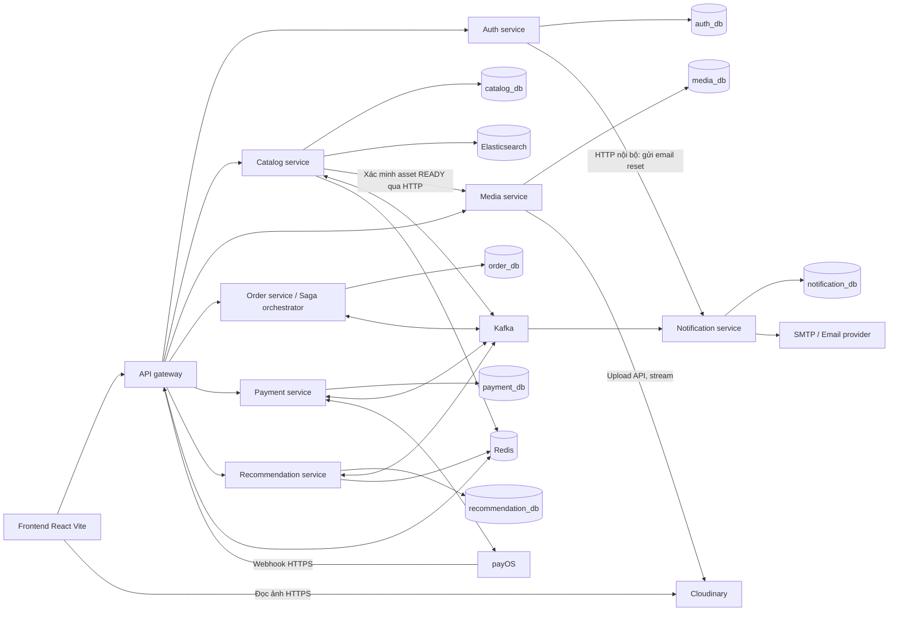
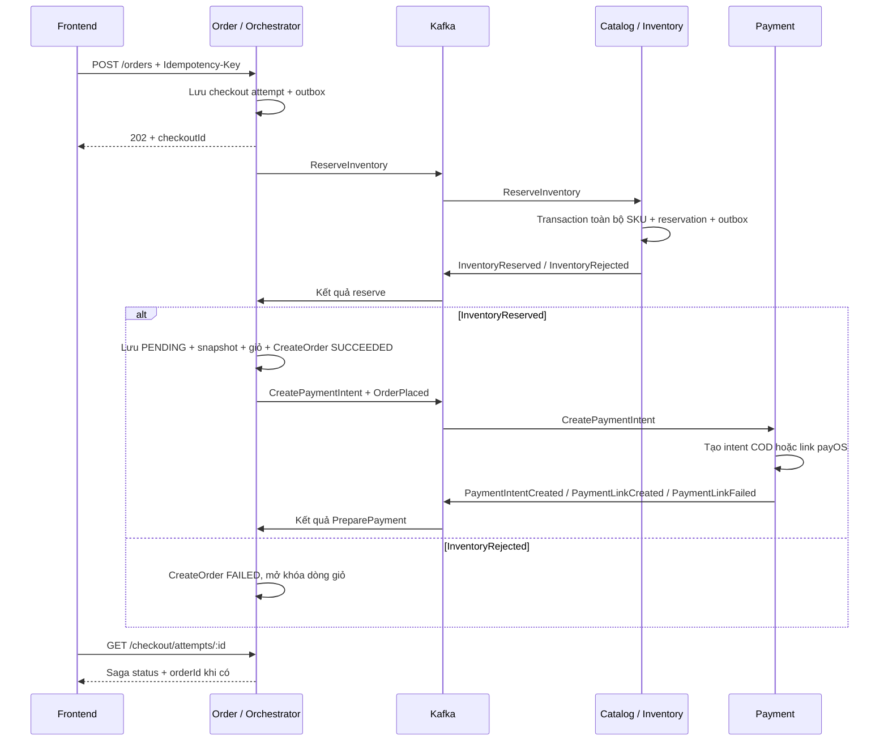
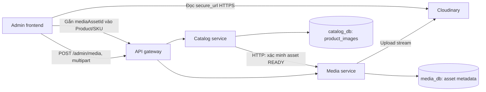

# Kiến trúc microservices và monorepo — Nexora

| Thông tin | Giá trị |
|---|---|
| Phiên bản | 1.6 |
| Ngày | 17/10/2026 |
| Trạng thái | Đã hợp nhất Git/npm workspaces và lockfile tại root; frontend + 6 ứng dụng NestJS đang ở mức scaffold; Media/Recommendation chưa có mã nguồn; Compose/pipeline là thiết kế mục tiêu |
| Stack | ReactJS + Vite, NestJS, PostgreSQL, Kafka, Elasticsearch, Redis, Cloudinary |
| Phát triển | Monorepo bằng npm workspaces; Docker Compose local là môi trường chính |
| Triển khai sau | AWS; giai đoạn đầu có thể dùng EC2 + Compose, sau đó chuyển ứng dụng sang ECS |
| Liên quan | [BRD](BRD.md), [SRS](SRS.md), [Database baseline](DATABASE_DESIGN.md) |

## 1. Các quyết định chính

Thiết kế gồm **7 service backend, 1 API gateway và 1 frontend**. Thư mục ứng dụng nằm trực tiếp tại root theo bố cục người phát triển đã đề xuất. Theo cấu trúc đích, mỗi ứng dụng NestJS là một project tiêu chuẩn, có package.json, nest-cli.json, tsconfig và Dockerfile riêng; npm workspaces quản lý toàn repository.

Các quyết định để giữ khối lượng phù hợp với đồ án:

- `catalog-service` giữ sản phẩm, danh mục, SKU, liên kết ảnh Product/SKU, tồn kho và tìm kiếm Elasticsearch.
- `order-service` giữ giỏ hàng, checkout, đơn hàng, dashboard và Saga orchestrator; orchestrator là NestJS provider trong Order, lưu tiến trình bền vững tại order_db.
- `recommendation-service` giữ tracking, dữ liệu hành vi và gợi ý theo quy tắc; sau này gọi model AI qua adapter.
- Saga dùng orchestration: Order gửi command, Catalog/Payment thực thi transaction local và trả result qua Kafka; Order quyết định bước tiếp theo hoặc compensation. Domain event vẫn dùng để cập nhật tìm kiếm, email và tracking/gợi ý.
- `media-service` là service nội bộ riêng, kiểm tra ảnh và chuyển tiếp upload tới **Cloudinary**; sở hữu metadata asset trong `media_db` và credential Cloudinary. Catalog chỉ liên kết asset đã READY; frontend đọc URL HTTPS của Cloudinary CDN. Nexora không lưu file gốc trên server hoặc database.
- Admin là nhóm API và màn hình trong từng miền nghiệp vụ.
- Worker outbox, consumer Kafka và worker email chạy cùng ứng dụng sở hữu chúng ở local; có thể tách process/replica khi triển khai sau.

Các yêu cầu đã chốt vẫn được áp dụng: đăng nhập trước khi thêm/xem/sửa giỏ; COD và payOS; email thông báo và khôi phục mật khẩu; danh mục cha–con và catalog đa ngành; thương hiệu chỉ là metadata seed; chưa hỗ trợ hoàn tiền hoặc hủy đơn đã PAID.

## 2. Service và quyền sở hữu dữ liệu

| Thành phần | Trách nhiệm | Dữ liệu sở hữu | Cổng container |
|---|---|---|---|
| `frontend` | Web Customer/Admin, gọi API gateway, theo dõi kết quả checkout | Trạng thái giao diện | 5173 ở local dev |
| `api-gateway` | Route API, CORS, xác thực đầu vào, rate limit, request ID, chuyển webhook payOS | Không có database nghiệp vụ | 3000 |
| `auth-service` | Đăng ký/đăng nhập, phiên, khóa tài khoản, hồ sơ, địa chỉ, địa giới, token reset mật khẩu | `auth_db` | 3000 nội bộ |
| `catalog-service` | Danh mục, Product/SKU, giá, liên kết ảnh, stock/ledger, giữ/xuất/hoàn hàng, import catalog, tìm kiếm | `catalog_db`, index Elasticsearch, projection URL ảnh | 3000 nội bộ |
| `media-service` | Kiểm tra/upload ảnh lên Cloudinary, metadata asset, chống upload lặp và phục hồi upload chưa rõ kết quả | `media_db`; chỉ service này giữ credential Cloudinary | 3000 nội bộ |
| `order-service` | Giỏ tài khoản, quote, checkout, Saga orchestrator, đơn/snapshot/lịch sử/ghi chú, dashboard | `order_db` | 3000 nội bộ |
| `payment-service` | Payment intent COD/payOS, payment link, webhook, đối chiếu provider, ghi nhận thu COD | `payment_db` | 3000 nội bộ |
| `notification-service` | Mẫu email, nhận yêu cầu gửi, retry, trạng thái gửi và adapter SMTP/API | `notification_db` | 3000 nội bộ |
| `recommendation-service` | Visitor/tracking session, event hành vi, export, gợi ý theo quy tắc, adapter AI tương lai | `recommendation_db` | 3000 nội bộ |

Ở local dùng **một PostgreSQL container với 7 database và 7 tài khoản ứng dụng riêng** (bao gồm `media_db`). Mỗi tài khoản chỉ được truy cập database của service mình. Cùng một PostgreSQL instance giúp chạy local gọn; ownership dữ liệu vẫn tách biệt.

ID của entity bên ngoài được lưu như reference, không có FK hoặc JOIN xuyên database. Ví dụ `order_items.variant_id` là mã SKU thuộc catalog; dòng đơn giữ snapshot tên, options (mã/nhãn/giá trị), ảnh và giá. Mỗi service giữ migration, ORM model và repository của riêng mình. Audit thay đổi được ghi tại service sở hữu thay đổi đó.

### 2.1. Sơ đồ tổng thể



Mũi tên HTTP phục vụ request cần kết quả ngay. Kafka truyền Saga command/result và domain event cho các projection bất đồng bộ. Sơ đồ thể hiện quyền sở hữu; các database có thể cùng nằm trong một PostgreSQL container ở local.

## 3. Giao tiếp và API gateway

### 3.1. HTTP nội bộ và Kafka

**HTTP nội bộ** dùng cho đăng nhập, hồ sơ, catalog, upload/xác minh asset Media, quote, đọc giỏ/đơn, search và các truy vấn cần phản hồi trực tiếp. Đọc nhiều SKU dùng API batch. Mọi request nội bộ có timeout và request ID; retry mutation chỉ khi có idempotency key.

**Kafka** dùng cho giữ/giải phóng/xuất/nhận lại hàng trong Saga, tạo payment intent/link, kết quả payment, cập nhật chỉ mục và chuyển event đến notification/recommendation.

NestJS hỗ trợ cả event và request/reply qua Kafka. Thiết kế này dùng `emit()` / `@EventPattern()` với command/result topic cho Saga và domain-event topic cho các subscriber khác; HTTP dùng cho truy vấn đồng bộ. Cách này tránh phụ thuộc vào reply topic của từng request HTTP. [NestJS — Kafka](https://docs.nestjs.com/microservices/kafka).

### 3.2. Route công khai

Prefix API là `/api/v1`; bảng dưới lược bỏ prefix để dễ đọc.

| Route qua gateway | Service nhận |
|---|---|
| `/auth/*`, `/me`, `/me/addresses/*`, `/locations/*`, `/admin/customers/*` | auth |
| `/products/*`, `/catalog/*`, `/admin/products/*`, `/admin/variants/*`, `/admin/categories/*`, `/admin/inventory/*` | catalog |
| `/admin/media`, `/admin/media/*` | media; Admin upload/tra cứu asset, không đi qua Catalog |
| `/cart/*`, `/checkout/*`, `/orders/*`, `/admin/orders/*`, `/admin/dashboard` | order |
| `/payments/payos/webhook` | payment; không yêu cầu đăng nhập, bắt buộc xác minh chữ ký tại payment |
| `/orders/:id/payments/payos` | order kiểm tra chủ đơn; orchestrator gửi EnsurePaymentLink với operationId khi cần tạo/lấy lại link, đọc kết quả từ payment projection |
| `/events`, `/recommendations` | recommendation |

Email được kích hoạt bởi service nội bộ/sự kiện, không có API công khai cho phép client tự chọn người nhận/template. Gửi lại payment link trả trạng thái đang xử lý nếu link chưa sẵn sàng; client đọc lại trạng thái của đơn.

### 3.3. Xác thực và phân quyền

- Auth sở hữu session/refresh token và trạng thái ACTIVE/LOCKED. Gateway gọi introspection nội bộ cho request cần đăng nhập để việc logout/khóa/đổi mật khẩu có hiệu lực với token cũ.
- Gateway xóa header danh tính do client tự gửi, rồi chuyển context được ký hoặc service credential được kiểm chứng. Service đích vẫn kiểm tra role và quyền sở hữu tài nguyên.
- Endpoint nội bộ không được frontend truy cập trực tiếp; Compose chỉ publish frontend và gateway. Không dùng một header `X-User-Id` không xác thực làm bằng chứng danh tính.
- Quyền tạo checkout được kiểm tra lúc tiếp nhận. Khóa tài khoản sau khi checkout đã được tiếp nhận không tự hủy nghiệp vụ đang chạy, tương tự quy tắc không tự hủy đơn cũ.

## 4. Saga orchestration tại Order

Order chứa orchestrator cho các operation checkout, chuẩn bị thanh toán, hủy, giao và nhận lại hàng. Orchestrator lưu trạng thái/step/version/operationId, gửi command qua outbox và xử lý result để tiến tiếp hoặc bù. Catalog và Payment chỉ thực thi phần nghiệp vụ mình sở hữu, trả result và phát domain event sau commit. [Saga orchestration](https://docs.aws.amazon.com/prescriptive-guidance/latest/cloud-design-patterns/saga-orchestration.html).

Mỗi transaction chỉ ghi database của một service. Tiến trình trong PostgreSQL là nguồn để tiếp tục sau restart; orchestrator không dựa vào biến bộ nhớ hoặc Redis để quyết định đã hoàn tất. Auth, Catalog, Media, Payment, Notification và Recommendation giữ ownership dữ liệu riêng.

### 4.1. Tạo đơn và chuẩn bị thanh toán

`checkout_attempts` lưu tiến trình CreateOrder và kết quả cho UI; `order_operations` lưu tiến trình PreparePayment, CancelOrder, ShipOrder, CompleteDelivery và ReceiveReturn. Hai bảng chứa saga type, current step, status, version, operationId, expected result, số lần thử và mốc retry/deadline theo nhu cầu. Trạng thái kỹ thuật tách khỏi trạng thái nghiệp vụ PENDING/CONFIRMED/SHIPPING/DELIVERED/CANCELLED.



Các bước:

1. Order kiểm tra auth, cart version và địa chỉ qua Auth; chụp dữ liệu cần cho đơn. Trong transaction Order, tạo checkout attempt, khóa sửa các dòng giỏ chọn mua và ghi ReserveInventory vào outbox với checkoutId/operationId cố định.
2. Catalog nhận command, kiểm tra giá/version, trạng thái bán và available. Transaction catalog_db giữ toàn bộ SKU hoặc không dòng nào, ghi reservation/snapshot và outbox result. Snapshot gồm tên/mã SKU, giá, ảnh đã chọn và options theo dạng mã → `{label, value}` từ cấu hình danh mục tại thời điểm reserve; Order lưu nguyên snapshot đã xác nhận. Retry cùng operationId không reserve thêm hoặc dựng lại snapshot từ catalog đã đổi.
3. Orchestrator nhận InventoryReserved, lưu đơn PENDING, snapshot/giá từ Catalog, expiresAt, lịch sử, xóa đúng dòng giỏ đã khóa và hoàn tất CreateOrder trong transaction order_db. Đồng thời lưu operation PreparePayment, command CreatePaymentIntent và domain event OrderPlaced vào outbox.
4. Payment nhận CreatePaymentIntent sau khi order đã tồn tại. COD tạo intent UNPAID; payOS lưu intent/provider order code rồi tạo link ngoài transaction DB. Kết quả được trả qua payment.results, orchestrator cập nhật operation và payment projection/link.
5. Domain event sau commit phục vụ Recommendation; Notification nhận NotificationRequested trên topic email riêng. Email/search/tracking không tham gia quyết định đơn đã được tạo thành công.

CreateOrder SUCCEEDED nghĩa là đơn đã được lưu, không đồng nghĩa payOS đã PAID hoặc link đã sẵn sàng. Lỗi tạo link giữ đơn UNPAID và cho thử lại cùng intent; PreparePayment có trạng thái chờ/retry/thất bại riêng, không tự bù reservation hoặc hủy đơn vì provider tạm lỗi.

### 4.2. Compensation và recovery

- Catalog từ chối trước khi giữ hàng: orchestrator đánh CreateOrder FAILED, mở khóa và giữ giỏ để sửa.
- Catalog đã giữ hàng nhưng Order lỗi database tạm thời: lưu/nhận lại result và tiếp tục commit theo operationId cũ; không tự giải phóng do timeout.
- Nếu có lý do nghiệp vụ chắc chắn để từ chối sau reserve và chưa tạo đơn, Order lưu quyết định COMPENSATING cùng ReleaseInventory trong outbox. Catalog release một lần, trả InventoryReleased; Order nhận result rồi mới kết thúc FAILED. Quyết định bù và tạo OrderPlaced loại trừ nhau bằng khóa/version trong Order.
- Result đến muộn/lặp được đối chiếu sagaId, operationId, step/version và trạng thái terminal. Participant giữ trạng thái đóng để command reserve/create đến muộn không mở lại reservation/intent.
- Worker của Order đọc saga đang chờ, query kết quả participant hoặc gửi lại cùng command/operationId, rồi tiến bước tiếp theo theo state machine. Worker tại participant phục hồi transaction local/outbox của mình.
- Reservation không tự release chỉ vì timeout; timeout là kết quả chưa biết. Reconciler kiểm tra Order/Payment trước khi kết luận được bù, tránh giải phóng hàng của đơn đã trả tiền.

Nếu khách chọn lưu địa chỉ mới, Order gửi API Auth với khóa chống lặp sau khi tạo đơn; lỗi lưu sổ địa chỉ retry độc lập và không đổi snapshot giao hàng. Chỉ các bước ảnh hưởng tính hợp lệ của đơn/tồn/payment nằm trong Saga tương ứng.

### 4.3. Trạng thái checkout và UI

| Trạng thái | Ý nghĩa |
|---|---|
| PROCESSING | Orchestrator đang reserve hoặc hoàn tất lưu đơn |
| COMPENSATING | Đã quyết định thất bại, đang chờ result giải phóng hàng |
| SUCCEEDED | CreateOrder hoàn tất; có orderId |
| FAILED | Bị từ chối hoặc các bước bù đã được xác nhận |
| REVIEW_REQUIRED | Kết quả chưa thể tự kết luận an toàn; cần đối soát |

POST /orders trả 202 + checkoutId. GET /checkout/attempts/:id chỉ cho chủ yêu cầu đọc; UI polling với backoff. Hết thời gian chờ UI vẫn giữ key/checkoutId để đọc tiếp. API đơn trả trạng thái chuẩn bị payment/link riêng; frontend không tự tạo đơn mới vì chờ link lâu.

### 4.4. Orchestration vòng đời đơn

| Nghiệp vụ | Các bước orchestrator và participant |
|---|---|
| Webhook payOS | Payment xác minh/commit payment transaction và PaymentConfirmed outbox → Order cập nhật projection, phát OrderPaymentConfirmed theo dữ liệu đơn; không ghi purchase lần hai |
| Hủy/24 giờ hết hạn | Order khóa operation, gửi CloseUnpaidPaymentIntent → chờ PaymentIntentClosed đúng reason CANCELLATION → gửi ReleaseInventory → chờ InventoryReleased → hoàn tất CANCELLED |
| Chuyển giao | Order kiểm tra CONFIRMED và payment nếu payOS, gửi CommitInventory → Catalog xuất on_hand/reserved một lần → InventoryCommitted → Order hoàn tất SHIPPING |
| Giao và thu COD | Order ghi xác nhận Admin, gửi RecordCodCollected → Payment ghi thu một lần và trả CodCollected → Order hoàn tất DELIVERED/PAID; PaymentConfirmed lặp không ghi giao dịch lại |
| Giao payOS đã PAID | Order chuyển DELIVERED bằng transaction local, giữ payment timestamp/transaction gốc |
| Nhận hàng về sau giao thất bại, chưa trả | Order ghi xác nhận nhận hàng, gửi CloseUnpaidPaymentIntent với reason RETURN → PaymentIntentClosed → gửi ReturnInventory → Catalog nhập lại một lần, trả InventoryReturned → Order hoàn tất CANCELLED |

Catalog xử lý command từ Order và không tự release/return khi nhìn thấy payment event. Orchestrator chỉ gửi bước stock sau result đóng payment hợp lệ. PaymentCancellationRejected làm operation hủy thất bại và giữ trạng thái đơn/tồn trước đó; UNKNOWN/provider lỗi giữ operation chờ đối soát. Order không dùng payment projection trễ để tự quyết định release.

Các operation dùng khóa/version trên Order để không nhận hủy và giao đồng thời. Payment serialize theo intent và chặn tạo/thu lại intent đã đóng. Stock command có orderId/reservationId/operationId và ý nghĩa bất biến; retry không lặp ledger. Khi participant đã commit mà Order chưa phản ánh, orchestrator tiếp tục từ result bền vững.

payOS là hệ thống ngoài, không có transaction chung với PostgreSQL. Tiền đến muộn sau khi đơn kết thúc được Payment lưu bằng chứng và đánh REVIEW_REQUIRED; không tự mở lại đơn hoặc giả refund. Hoàn tiền vẫn ngoài phạm vi. [payOS — API](https://payos.vn/docs/api/).

## 5. Thiết kế dữ liệu sau khi tách service

`DATABASE_DESIGN.md` là baseline của mô hình một database trước quyết định microservices. Các cột nghiệp vụ vẫn hữu ích, nhưng các FK, transaction và tổng số 29 bảng trong baseline không phải schema triển khai phân tán.

| Service | Bảng nghiệp vụ từ baseline | Bổ sung hoặc điều chỉnh |
|---|---|---|
| Auth | users, auth_sessions, password_reset_tokens, location_datasets, provinces, wards, user_addresses | Audit auth; gửi yêu cầu reset-email idempotent qua HTTP, cho khách yêu cầu lại nếu chưa tạo được job |
| Catalog | categories, brands metadata, products, product_variants, product_images, catalog_datasets, retailrocket_category_mappings, inventory_movements | inventory_reservations, reservation_items; product/search version; audit catalog |
| Media | Tách metadata upload khỏi product_images | media_assets trong media_db; trạng thái upload/idempotency, asset_id/public_id/version/secure_url Cloudinary; audit media; product_images giữ media_asset_id và projection để đọc |
| Order | carts, cart_items, orders, order_items, order_status_history, order_notes, idempotency_requests | checkout_attempts và order_operations lưu Saga type/step/status/version, result và retry/deadline; payment projection; audit order |
| Payment | Các trường thanh toán trước đây nằm trên orders | payment_intents, payment_transactions, provider_webhook_receipts; UQ provider order code/transaction reference; operation dedupe |
| Notification | email_outbox | notification_jobs: recipient, template, retry, delivery status; không FK sang user/order database |
| Recommendation | visitors, tracking_sessions, interaction_events, recommendation_requests, recommendation_items | Catalog projection tối thiểu cho gợi ý; không lưu contact/địa chỉ trong event/export |

Mỗi service có phát/nhận message nghiệp vụ bổ sung `outbox_messages` và `inbox_messages` theo nhu cầu. Đây là infrastructure của service, không có một outbox database chung cho toàn hệ thống.

### 5.1. Stock và payment là nguồn sự thật ở đâu?

- Catalog: on_hand/reserved, reservation và inventory ledger là nguồn sự thật tồn kho. Đối soát reserved bằng reservation_items còn HELD trong catalog_db, không JOIN bảng orders.
- Payment: intent/transaction là nguồn sự thật thanh toán. Các trường payment trên Order là projection; thao tác quan trọng hỏi trạng thái authoritative khi cần.
- Order: nguồn sự thật nội dung đơn, snapshot và vòng đời đơn. Cart lưu PostgreSQL để tồn tại qua logout/restart; Redis có thể cache.
- Recommendation: event hành vi phục vụ nghiên cứu là bản ghi tiêu thụ từ sự kiện đã commit. Event `transaction` được tạo một lần theo dòng đơn từ kết quả thanh toán, dùng ID ổn định để chống lặp.

Recommendation cập nhật catalog projection từ payload công khai có version hoặc gọi API batch nội bộ của Catalog khi nhận event; không đọc catalog_db trực tiếp. Order phát event giao dịch theo dòng sau khi áp dụng kết quả Payment, giữ paidAt gốc thay vì thời gian consumer nhận message.

Catalog đánh dấu SKU đã được dùng trong reservation/đơn được chấp nhận để không đổi product_id/options; không xóa dấu khi release và không cần đọc trực tiếp order_items ở database khác.

Catalog sở hữu `categories.parent_id/attribute_config`, `products.attributes/variant_option_keys`, `product_variants.options/options_key` và ảnh chung/ảnh SKU. Cấu hình thuộc tính nằm trong form Category, không có service/module thuộc tính riêng; không kế thừa cấu hình cha trong bản đầu. Sửa cây có khóa cấp cây để chặn chu trình đồng thời; sửa cấu hình/đổi danh mục Product phải giữ Product/SKU đang bán hợp lệ. SKU có giá/tồn riêng; sản phẩm không biến thể có một SKU options `{}`. Các cột/ràng buộc chi tiết tại [Database mục 4](DATABASE_DESIGN.md#catalog); quy tắc này áp dụng cho catalog_db hiện tại, độc lập các FK/transaction xuyên miền của baseline.

Các khóa chống lặp bắt buộc ở miền nghiệp vụ: checkout attempt có UQ `(user_id, idempotency_key)` kèm request hash; orders có checkoutId duy nhất; reservation có checkoutId duy nhất và các dòng SKU duy nhất; stock operation có operationId duy nhất theo loại/dòng; payment intent có orderId duy nhất, provider order code và transaction reference có UQ phù hợp. Inbox chống message lặp, còn các khóa này chống cùng thao tác nghiệp vụ được gửi bằng messageId khác. Command/result đến muộn không được mở lại reservation/intent đã đóng; handler kiểm tra trạng thái/version hoặc ghi trạng thái đóng để chặn thao tác cũ.

Provider call nằm ngoài transaction database: Payment lưu intent/provider order code ổn định trước khi gọi payOS. Nếu timeout hoặc dừng sau khi provider tạo link, retry tra kết quả bằng cùng provider order code rồi phục hồi dữ liệu local; không cấp code mới và tạo thêm link như một thanh toán mới khi kết quả cũ chưa rõ.

## 6. Kafka và độ tin cậy message

### 6.1. Topic Saga và domain event

| Topic | Message chính | Producer → Consumer |
|---|---|---|
| `nexora.catalog.commands.v1` | ReserveInventory, ReleaseInventory, CommitInventory, ReturnInventory | Order orchestrator → Catalog |
| `nexora.catalog.results.v1` | InventoryReserved/Rejected/Released/Committed/Returned | Catalog → Order orchestrator |
| `nexora.payment.commands.v1` | CreatePaymentIntent, EnsurePaymentLink, CloseUnpaidPaymentIntent, RecordCodCollected | Order orchestrator → Payment |
| `nexora.payment.results.v1` | PaymentIntentCreated, PaymentLinkCreated/Failed, PaymentIntentClosed, PaymentCancellationRejected, CodCollected | Payment → Order orchestrator |
| `nexora.payment.events.v1` | PaymentConfirmed từ webhook hoặc thu COD đã commit | Payment → Order |
| `nexora.order.events.v1` | OrderPlaced, OrderCancelled, OrderShipped, OrderDelivered, OrderPaymentConfirmed | Order → Recommendation và các projection nghiệp vụ |
| `nexora.catalog.events.v1` | ProductSearchChanged, metadata công khai có version | Catalog → Catalog indexer, Recommendation |
| `nexora.notification.events.v1` | NotificationRequested với dữ liệu email tối thiểu | Service nguồn → Notification; topic riêng hạn quyền/retention |

Key của checkout trước khi có đơn là checkoutId; sau khi có đơn là orderId. correlationId/sagaId nối command/result về tiến trình. Event catalog dùng productId. Không có thứ tự toàn cục giữa các topic; orchestrator và participant kiểm tra operationId/step/version.

Command/result điều khiển các bước Saga; domain event phục vụ subscriber sau commit. Payment tạo intent theo CreatePaymentIntent, không tự tạo từ OrderPlaced. Catalog thay đổi reservation theo command tương ứng, không tự thay tồn theo payment event. Mỗi request tạo/lấy lại link đi qua kiểm tra quyền Order rồi EnsurePaymentLink với operationId bền vững.

Ví dụ envelope dùng chung:

```json
{
  "messageId": "uuid",
  "type": "inventory.reserved.v1",
  "schemaVersion": 1,
  "producer": "catalog-service",
  "occurredAt": "2026-10-16T10:00:00Z",
  "correlationId": "checkout-id",
  "sagaId": "checkout-id",
  "operationId": "reserve-operation-id",
  "causationId": "reserve-command-message-id",
  "aggregateId": "checkout-id",
  "aggregateVersion": 1,
  "payload": { "reservationId": "101", "checkoutId": "checkout-id" }
}
```

Message/correlation/saga/operation ID có thể UUID; entity PK PostgreSQL vẫn có thể bigint identity, serialize thành chuỗi. Contract mới bổ sung field tương thích hoặc tăng version; không dùng shared ORM entity làm payload.

### 6.2. Outbox, inbox, ordering và retry

1. Service ghi dữ liệu nghiệp vụ và outbox trong **cùng transaction local**. Relay trong service phát message sau commit và đánh dấu đã publish. Relay có thể publish lặp khi dừng giữa chừng. [Transactional outbox](https://microservices.io/patterns/data/transactional-outbox.html).
2. Consumer dùng UQ `(consumer_name, message_id)` trong inbox. Cập nhật nghiệp vụ, inbox và outbox kết quả cùng transaction. Chỉ commit offset Kafka khi xử lý đã bền vững; khi publish DLQ phải chờ broker ack hoặc lưu ý định DLQ bền vững trước khi ack message gốc.
3. Kafka giữ thứ tự trong từng partition, không giữ thứ tự toàn bộ topic hay giữa các topic. Saga vẫn kiểm tra operation/version; key giống nhau ở hai topic không tạo thứ tự xuyên topic. [Apache Kafka — design](https://kafka.apache.org/41/design/design/).
4. Mỗi logical subscriber có consumer group riêng, ví dụ `order-saga`, `catalog-command-handlers`, `payment-command-handlers`, `catalog-search-indexer`, `notification-email`, `recommendation-projection`. Replica cùng subscriber chia sẻ group. Nếu notification và recommendation dùng chung group, mỗi bên chỉ nhận một phần message.
5. Retry lỗi tạm thời với backoff và giới hạn, DLQ chứa metadata tra cứu. Order recovery worker kiểm tra Saga treo/thiếu result; participant recovery worker xử lý outbox/local operation chưa hoàn tất. Re-drive dùng lại message/operation ID để không áp dụng nghiệp vụ hai lần.

Mục tiêu là giao message ít nhất một lần, kèm idempotency ở nghiệp vụ. Không tuyên bố Kafka bảo đảm đúng một lần cho cả PostgreSQL, email và payOS.

Domain/tracking topic không chứa email, địa chỉ, token hoặc provider credential. Notification nhận request gửi thư qua topic riêng được giới hạn quyền/retention; Order tạo request này từ snapshot riêng, dùng cùng business event ID để dedupe. Không đưa payload email vào event export cho AI.

## 7. Elasticsearch, Redis và email

### 7.1. Elasticsearch trong Catalog

Catalog ghi PostgreSQL và outbox `ProductSearchChanged` trong transaction; indexer tiêu thụ rồi đọc trạng thái hiện tại từ catalog_db và upsert/delete index. Elasticsearch là projection tìm kiếm có độ trễ, có thể rebuild từ PostgreSQL. [Elastic — near real-time search](https://www.elastic.co/docs/manage-data/data-store/near-real-time-search).

- Một document/Product; lưu category_id và category_ancestor_ids để lọc cả danh mục con. SKU là trường `nested`, chứa options dạng `flattened` với mã ổn định và giá trị đã normalize_label; giá/tồn là trường số riêng. Tất cả điều kiện options + giá + còn hàng nằm trong cùng nested query. OR giữa giá trị cùng mã, AND giữa các mã. Không tạo dynamic field mapping riêng cho từng thuộc tính. [Elastic — nested](https://www.elastic.co/docs/reference/elasticsearch/mapping-reference/nested), [Elastic — flattened](https://www.elastic.co/docs/reference/elasticsearch/mapping-reference/flattened).
- Bản đầu chỉ lọc exact value trên options; không dùng flattened để so khoảng số theo dung lượng/kích cỡ, chưa lọc products.attributes. Facet lấy từ dữ liệu Catalog trong phạm vi danh mục; nhãn/ý nghĩa mã phải nhất quán trong phạm vi gộp. Mã mơ hồ bị ẩn và API từ chối lọc mã đó, yêu cầu chọn danh mục cụ thể hơn. PostgreSQL fallback dùng cùng chuẩn hóa và một EXISTS cho toàn bộ điều kiện SKU.
- Dùng analyzer chuẩn hóa lowercase/bỏ dấu theo yêu cầu tìm tên; tên synthetic tiếng Anh vẫn tìm được. Không thêm plugin ngôn ngữ ngoài khi chưa cần.
- Thay đổi nội dung/SKU/stock làm tăng product search version trong Catalog. Indexer không để event/version cũ ghi đè document mới; reindex dùng index mới và đổi alias.
- Đổi cây danh mục làm cập nhật ancestor projection cho Product thuộc nhánh ảnh hưởng; đổi cấu hình nhãn làm cập nhật payload hiển thị/facet. Catalog ghi outbox yêu cầu rebuild nhánh theo batch, tăng version từng Product bị ảnh hưởng; không chỉ cập nhật document của danh mục cha. Khi index đang trễ, Catalog đối chiếu phạm vi danh mục hiện hành trước trả kết quả; kết quả có thể thiếu tạm thời, không trộn phạm vi cũ. Bộ lọc/checkout không đọc cấu hình cũ từ cache làm nguồn quyết định.
- Giá và tồn trên kết quả tìm kiếm chỉ phục vụ hiển thị. Catalog kiểm tra lại PostgreSQL ở thêm giỏ/quote/reserve. Kết quả ES cần hydrate/kiểm tra Product đang công khai trước trả để sản phẩm vừa ngừng bán không lộ do index trễ.
- ES lỗi: Catalog fallback tìm/lọc PostgreSQL cho catalog 500 sản phẩm, giữ checkout hoạt động. Có lệnh rebuild index, không reset database để sửa chỉ mục.

### 7.2. Redis

| Nơi dùng | Công dụng |
|---|---|
| Gateway/Auth | Counter rate limit đăng nhập, yêu cầu reset và API |
| Catalog | Cache category, product public và query phổ biến với TTL ngắn |
| Recommendation | Cache kết quả gợi ý theo user/session và thống kê phổ biến có thể tái tạo |

Một Redis container local, key có prefix môi trường/service, ví dụ `local:catalog:product:101`. Cache có TTL và invalidation sau commit. Giỏ, reset token, stock, Saga và payment vẫn lưu PostgreSQL. Consumer dedupe và idempotency nghiệp vụ cũng nằm PostgreSQL.

Redis lỗi thì các cache có thể bỏ qua; với rate limit luồng nhạy cảm, dùng chính sách fallback có giới hạn hoặc trả lỗi tạm thời được cấu hình rõ. Không dùng Redis lock làm cơ chế duy nhất chống bán vượt tồn. Catalog khóa/cập nhật stock trong PostgreSQL.

### 7.3. Email và khôi phục mật khẩu

Auth sinh token reset, lưu hash và hạn dùng; Notification chịu trách nhiệm gửi. Với token rõ, dùng HTTP nội bộ tới Notification để gửi/lưu job, payload nhạy cảm được mã hóa khi lưu và xóa khi gửi xong/hết hạn. Token không đi trong domain/tracking topic hoặc log. Auth chỉ trả phản hồi chung cho email có/không có tài khoản; lỗi gửi cho phép yêu cầu lại.

Email đơn dùng NotificationRequested trên topic email riêng có recipient và template data tối thiểu; Notification tạo job có UQ `(source_event_id, template_key, recipient)` rồi worker gửi với retry. Nếu provider hỗ trợ idempotency key thì dùng job ID. Nếu provider không hỗ trợ, dừng sau gửi nhưng trước lưu SENT có thể gây gửi lại; dedupe local không chứng minh email được phát đúng một lần tuyệt đối.

Local có thể dùng Mailpit để xem thư; kiểm tra gửi email thật cần cấu hình SMTP/API thực. AWS có thể dùng SES qua cùng adapter.

Yêu cầu reset có requestId để Notification dedupe HTTP retry; khi kết quả gửi chưa rõ, Auth tra/retry cùng requestId. Job reset quá hạn không gửi tiếp. Phát hành token mới vô hiệu hóa token cũ; token rõ chỉ được giữ trong job đã mã hóa cho tới khi gửi hoặc hết hạn, còn Auth chỉ lưu hash.

<a id="media-service"></a>
### 7.4. Media Service và Cloudinary

`media-service` là ứng dụng NestJS trong monorepo; **Cloudinary** là nhà cung cấp upload/lưu trữ/phân phối ảnh bên ngoài. Media sở hữu `media_db`, validation ảnh, trạng thái upload và Cloudinary adapter. Catalog sở hữu liên kết ảnh với Product/SKU, ảnh đại diện, thứ tự và văn bản thay thế. Không dùng chung database hoặc credential giữa hai service.



Luồng upload: Admin → Gateway → Media kiểm tra JPEG/PNG/WebP, tối đa 5 MiB/file → stream/buffer giới hạn tới Cloudinary ngoài transaction DB → ghi metadata và READY vào `media_db` → trả `mediaAssetId` và `cdnUrl`. Admin dùng ID này để gắn ảnh qua Catalog. Catalog xác minh bằng HTTP nội bộ trước transaction ghi liên kết, không tin URL/trạng thái do browser gửi. Chi tiết API tại [SRS mục 8.1.1](SRS.md#media-api), retry tại mục 7.4.2 và [cấu hình Cloudinary](#media-config).

Nexora không ghi bản gốc vào filesystem, volume hoặc database. Upload lỗi hoặc timeout chưa rõ kết quả không được coi READY; retry cùng idempotency key phải đối soát asset trước khi upload lại. Media không tham gia Saga checkout và không truyền byte ảnh qua Kafka.

Product ACTIVE cần một ảnh chung READY làm đại diện; ảnh SKU là tùy chọn và fallback ảnh chung. Một asset có thể được nhiều liên kết dùng lại. Catalog lưu projection URL/version để đọc ảnh không cần gọi Media mỗi lần; Order và reservation giữ snapshot asset/URL. Thay ảnh tạo asset mới, không ghi đè public_id cũ. Bản đầu chỉ gỡ liên kết tại Catalog, giữ asset đã READY trên Cloudinary để bảo toàn lịch sử; chưa cung cấp API xóa vật lý. Dọn asset sau này cần xác minh mọi tham chiếu và ngăn gắn mới đồng thời.

Seed placeholder upload qua Media bằng service credential, rồi Catalog kiểm tra asset READY trước nhập lô. `source_url` của CSV là provenance, không hotlink placehold.co. Demo đọc CDN cần mạng; CDN lỗi thì UI dùng fallback ảnh. Backup Nexora giữ metadata và tham chiếu, không có kho file gốc riêng; việc lưu trữ và backup asset tại Cloudinary phụ thuộc cấu hình tài khoản.

Bản đầu nhận một file ảnh mỗi request; video, tài liệu, avatar và upload trực tiếp từ browser lên Cloudinary chưa thuộc phạm vi. Giới hạn số upload đồng thời để tổng bộ nhớ không tăng vô hạn.

#### 7.4.1. Luồng upload và gắn ảnh

1. Admin gọi `POST /api/v1/admin/media`, multipart field `file`, kèm `Idempotency-Key`. Gateway xác thực, bỏ header danh tính giả do client gửi và chuyển context nội bộ đã xác thực tới Media.
2. Media kiểm tra quyền, kích thước, định dạng thực và khả năng giải mã ảnh; không chỉ tin extension/MIME khai báo. Không nhận URL tùy ý, đường dẫn filesystem, `public_id` hoặc cờ overwrite từ browser.
3. Media ghi bản ghi PENDING cùng khóa chống lặp, fingerprint nội dung và `public_id` dự kiến do server sinh vào `media_db`, rồi kết thúc transaction. Một `public_id` duy nhất cho mỗi asset, có namespace môi trường để tách dev/test/prod.
4. Media upload ngoài transaction DB bằng Cloudinary Node SDK `upload_stream`, cấu hình `resource_type=image`, `type=upload`, `overwrite=false`. SDK dùng credential phía backend. [Cloudinary Node upload](https://cloudinary.com/documentation/node_image_and_video_upload).
5. Khi Cloudinary xác nhận thành công, Media lưu `asset_id`, `public_id`, `version`, `secure_url`, format, bytes và kích thước; chỉ commit READY khi metadata đã hợp lệ. `cdnUrl` trong API ánh xạ từ `secure_url` HTTPS. [Cloudinary Upload API](https://cloudinary.com/documentation/image_upload_api_reference).
6. Trả `201` với `mediaAssetId`, `status=READY`, `cdnUrl`, `version`, `format`, `bytes`, `width`, `height`. ID nội bộ serialize thành chuỗi. Giải phóng buffer ở mọi nhánh.
7. Admin gọi API ảnh Product của Catalog với `mediaAssetId` và thông tin liên kết. Catalog lấy metadata READY từ Media qua HTTP nội bộ, xác minh Product/SKU rồi ghi liên kết và projection trong transaction `catalog_db`. Không nhận `cdnUrl`, provider hoặc trạng thái READY do client tự khai làm nguồn sự thật.

Upload thành công chưa đồng nghĩa đã gắn Product. Gắn ảnh thất bại không rollback upload Cloudinary; Admin có thể dùng lại cùng ID. Catalog không cần Cloudinary credential, không upload file và không gọi Media mỗi lần đọc sản phẩm. Product ACTIVE cần ảnh chung đại diện READY; ảnh SKU là tùy chọn và fallback ảnh chung.

#### 7.4.2. Chống lặp và phục hồi

- Khóa chống lặp duy nhất theo `(requester_scope, idempotency_key)`, với scope do server lấy từ Admin hoặc job seed đã xác thực. Fingerprint bao gồm hash bytes và tham số upload đã chuẩn hóa. Cùng key khác fingerprint trả `409`; cùng key đã READY trả cùng asset, không upload lại. Seed dùng key ổn định theo dataset version và mã ảnh nguồn.
- PENDING là trạng thái đã tiếp nhận hoặc chưa xác định được kết quả. Timeout, mất kết nối hoặc service dừng sau khi Cloudinary nhận ảnh không được kết luận FAILED ngay. Worker dùng lease trong `media_db` để đối soát `public_id` dự kiến; metadata kết quả phải khớp operation trước khi chuyển READY.
- Khi Cloudinary đã upload nhưng commit DB lỗi, worker khôi phục metadata theo ID đã lưu. Không có transaction phân tán giữa Cloudinary và PostgreSQL. Chỉ upload lại cùng ID, `overwrite=false`, sau khi đã xác minh lần trước chưa tạo asset; không có bytes để retry sau restart thì yêu cầu client gửi lại file với cùng key.
- FAILED chỉ dùng khi có kết quả thất bại chắc chắn. Sau khi sửa file/yêu cầu, client dùng key mới. Không lưu nguyên response lỗi provider có thể chứa thông tin nhạy cảm.
- Media lỗi không làm mất URL đã được lưu trong Catalog/Order; đọc ảnh vẫn qua CDN. Upload/gắn ảnh mới báo lỗi rõ khi không thể xác minh. Không đưa Media vào Saga checkout hoặc chuyển byte ảnh qua Kafka.

## 8. Cấu trúc monorepo

Monorepo hiện dùng một Git repository, npm workspaces và lockfile tại root; xem [README](../README.md) để chạy scaffold hiện có. Cây dưới đây vẫn là **cấu trúc đích đầy đủ**: packages, database, Dockerfile, infra, Compose và CI chưa được tạo. Media/Recommendation hiện chỉ có `.gitkeep`. Tên root có thể là `ecommerce/` hoặc `nexora/`; workspace local hiện mang tên `dacn/`.

```text
ecommerce/
├── frontend/                         # React + Vite, Customer và Admin
│   ├── src/
│   │   ├── app/                      # router, providers, layout
│   │   ├── features/                 # auth, catalog, cart, checkout, orders, admin
│   │   ├── components/
│   │   └── lib/                      # API client, formatting
│   ├── public/
│   ├── package.json
│   ├── tsconfig.json
│   ├── vite.config.ts
│   └── Dockerfile
├── api-gateway/
│   ├── src/                          # routing, auth context, throttle, health
│   ├── package.json
│   ├── nest-cli.json
│   ├── tsconfig.json
│   └── Dockerfile
├── auth-service/
│   ├── src/modules/                  # auth, users, addresses, locations
│   ├── database/                     # schema, migrations, seed của auth
│   ├── package.json
│   ├── nest-cli.json
│   ├── tsconfig.json
│   └── Dockerfile
├── catalog-service/
│   ├── src/modules/                  # categories, products, inventory, search, image-links
│   ├── database/
│   ├── package.json
│   ├── nest-cli.json
│   ├── tsconfig.json
│   └── Dockerfile
├── media-service/
│   ├── src/modules/                  # uploads, assets, Cloudinary adapter
│   ├── src/workers/                  # đối soát upload PENDING sau timeout/restart
│   ├── database/                     # media_assets, migrations, audit media
│   ├── package.json
│   ├── nest-cli.json
│   ├── tsconfig.json
│   └── Dockerfile
├── order-service/
│   ├── src/modules/                  # cart, checkout, orders, dashboard
│   ├── src/sagas/                    # orchestrator cho checkout/payment/lifecycle
│   ├── src/workers/                  # outbox relay và saga recovery
│   ├── database/
│   ├── package.json
│   ├── nest-cli.json
│   ├── tsconfig.json
│   └── Dockerfile
├── payment-service/
│   ├── src/modules/                  # intents, cod, payos, webhooks
│   ├── database/
│   ├── package.json
│   ├── nest-cli.json
│   ├── tsconfig.json
│   └── Dockerfile
├── notification-service/
│   ├── src/modules/                  # delivery, templates, SMTP/API adapter
│   ├── database/
│   ├── package.json
│   ├── nest-cli.json
│   ├── tsconfig.json
│   └── Dockerfile
├── recommendation-service/
│   ├── src/modules/                  # tracking, recommendations, export
│   ├── database/
│   ├── package.json
│   ├── nest-cli.json
│   ├── tsconfig.json
│   └── Dockerfile
├── packages/
│   ├── contracts/                    # DTO giao tiếp, event envelope/schema, topic names
│   │   ├── src/
│   │   ├── package.json
│   │   └── tsconfig.json
│   └── platform/                     # logger, tracing, config, outbox/inbox helpers
│       ├── src/
│       ├── package.json
│       └── tsconfig.json
├── infra/
│   ├── postgres/init/                # tạo 7 DB/user, gồm media_db; không chứa migration miền
│   ├── kafka/                        # topic init và retention local
│   ├── elasticsearch/                # mapping/analyzer/index template
│   └── aws/                          # IaC/EC2 bootstrap/ECS definitions khi làm CD
├── scripts/                          # chạy migrate/seed/smoke ở root
├── tests/integration/                # kiểm tra Saga xuyên service
├── docs/
├── .github/workflows/
│   ├── ci.yml
│   ├── publish-images.yml
│   └── deploy-aws.yml                # thêm/kích hoạt khi triển khai AWS
├── package.json                      # private, workspaces, scripts root
├── package-lock.json                 # một lockfile cho toàn monorepo
├── tsconfig.base.json
├── .env.example
├── .gitignore
├── .dockerignore
├── docker-compose.yaml               # môi trường local chính
└── docker-compose.aws.yaml           # override tương lai cho EC2, khi cần
```

`packages/contracts` chia sẻ hợp đồng giao tiếp và schema validation ở runtime, không chia sẻ ORM entity/repository/nghiệp vụ. `packages/platform` chỉ chứa tiện ích kỹ thuật nhỏ; mỗi service vẫn có migration outbox/inbox của riêng nó. Frontend chỉ phụ thuộc phần contract dành cho public API, không kéo thư viện NestJS backend vào browser bundle.

### 8.1. Ví dụ bên trong một Nest service

```text
order-service/
├── src/
│   ├── main.ts
│   ├── app.module.ts
│   ├── config/
│   ├── modules/
│   │   ├── cart/
│   │   │   ├── cart.module.ts
│   │   │   ├── cart.controller.ts
│   │   │   ├── cart.service.ts
│   │   │   ├── cart.repository.ts
│   │   │   └── dto/
│   │   ├── checkout/
│   │   ├── orders/
│   │   └── dashboard/
│   ├── sagas/
│   │   ├── create-order.saga.ts
│   │   ├── prepare-payment.saga.ts
│   │   ├── cancel-order.saga.ts
│   │   ├── ship-order.saga.ts
│   │   └── complete-delivery.saga.ts
│   ├── workers/
│   │   ├── outbox-relay.worker.ts
│   │   └── saga-recovery.worker.ts
│   ├── messaging/                    # consumer handlers, outbox relay
│   ├── clients/                      # Auth HTTP client, Catalog quote client
│   └── health/
├── database/
│   ├── migrations/
│   └── seed.ts
├── test/
├── package.json
├── nest-cli.json
├── tsconfig.json
├── tsconfig.build.json
└── Dockerfile
```

Tổ chức theo module nghiệp vụ, controller mỏng, service xử lý nghiệp vụ, repository làm việc với database. Saga provider trong Order lưu tiến trình, xử lý result và gửi command qua outbox. Catalog/Payment có command handler thực thi transaction local; các subscriber khác xử lý domain event. Có thể thêm lớp domain/application khi độ phức tạp thực tế cần, chưa cần tạo nhiều lớp rỗng cho mỗi module CRUD.

### 8.2. npm workspaces và build

Cấu hình đã có tại root: `package.json` private tên `nexora`, workspaces `frontend`, `api-gateway`, `*-service`, một `package-lock.json` và `.git`. Các ứng dụng có package name `@nexora/<tên-thư-mục>`. Media/Recommendation chưa có package.json nên chưa được npm chạy; sẽ tự tham gia workspace khi được triển khai.

Dùng Node.js 24 và npm 11 theo `.nvmrc`/`packageManager`. Cài tại root bằng `npm ci`; root scripts `build`, `lint`, `typecheck`, `test`, `test:e2e` chạy các workspace có script tương ứng. Chạy riêng bằng `npm run build --workspace=@nexora/catalog-service`; thêm dependency bằng `npm install <package> --workspace=@nexora/catalog-service`. [npm workspaces](https://docs.npmjs.com/cli/v11/using-npm/workspaces/).

`.gitignore`, `.gitattributes`, Prettier và Oxlint dùng chung tại root. `tsconfig.base.json` chứa cấu hình chung cho NestJS; từng backend giữ package.json, nest-cli.json, tsconfig.json, tsconfig.build.json và Vitest config để build/test độc lập. Frontend giữ ESLint và cấu hình TypeScript riêng cho React/Vite. README mẫu và các cấu hình chung trùng lặp đã được gom về root.

Không giữ Git repository hoặc package-lock riêng trong từng ứng dụng. npm có thể tạo node_modules con cho dependency khác phiên bản hoặc cache công cụ; đó là dữ liệu sinh tự động, không phải repository riêng và được Git bỏ qua.

Khi bổ sung `packages/contracts`/`packages/platform`, thêm `packages/*` vào workspaces và build shared package trước các app phụ thuộc; hiện chưa có các package này nên root không gọi build:shared. Dependency nội bộ dùng phiên bản workspace tương thích; package exports trỏ đến JavaScript đã build, không chỉ dựa TypeScript path alias.

Dockerfile là bước triển khai sau, gồm stage development/build/runtime. **Build context là root monorepo**, ví dụ `context: .`, `dockerfile: order-service/Dockerfile`, để đọc root lockfile và packages khi có. Runtime image chỉ chứa ứng dụng, shared build và production dependencies cần thiết; tránh dùng node_modules host Windows trong Linux container.

## 9. Docker Compose local

| Container | Mục đích | Publish ra host |
|---|---|---|
| frontend | Vite dev server bind 0.0.0.0 | 5173 |
| api-gateway | Public API | 3000 |
| 7 service backend | HTTP nội bộ; Kafka consumers/workers theo nhu cầu, Media dùng HTTP và worker phục hồi | Không publish mặc định |
| postgres | 7 database và persistent volume | Chỉ mở cổng khi cần debug |
| kafka | Một node KRaft, topic init; replication factor 1 ở local | Broker ngoài riêng khi cần debug |
| elasticsearch | Single node + persistent volume | Chỉ mở cổng debug khi cần |
| redis | Cache/counter | Chỉ mở cổng debug khi cần |
| kafka-ui, mailpit | Công cụ quan sát message/email | Profile `tools` |
| migrate, seed | Job một lần, gọi script của từng service | Profile `setup` |

Kafka có listener nội bộ `kafka:9092`; nếu mở cho công cụ host thì cấu hình listener ngoài riêng, ví dụ `localhost:19092`. Container dùng DNS service của Compose, không dùng localhost để gọi container khác.

Compose đặt healthcheck cho PostgreSQL/Kafka/Elasticsearch/Redis, `depends_on` theo `service_healthy` hoặc init job hoàn thành. Mỗi ứng dụng vẫn cần reconnect/backoff khi dependency khởi động lại; thứ tự startup không bảo đảm dependency luôn sẵn sàng. [Docker — startup order](https://docs.docker.com/compose/how-tos/startup-order/).

Luồng thao tác mục tiêu khi đã có scaffold:

```bash
cp .env.example .env
docker compose --profile setup run --rm migrate
docker compose --profile setup run --rm seed
docker compose up --build
# Nếu cần xem thư và Kafka UI:
docker compose --profile tools up --build
```

Job migrate/seed tự kéo dependency cần thiết, chạy theo service sở hữu; seed là thao tác chủ động, chạy lại không ghi đè dữ liệu Admin. Các lệnh trên là hợp đồng vận hành dự kiến, chưa chạy được trước khi viết Compose/scaffold.

Mỗi service nhận biến môi trường cần dùng: DATABASE_URL riêng, KAFKA_BROKERS, service URL; chỉ payment nhận payOS keys, chỉ notification nhận email provider credential, chỉ media nhận Cloudinary credential. Frontend chỉ nhận public API URL, không nhận backend secret. Pin tag/digest image thay vì `latest` khi tạo môi trường tái lập.

Media Service upload tới Cloudinary ngay cả khi chạy Compose local; Nexora chỉ lưu metadata và không có media volume chứa file gốc. Media nhận DATABASE_URL của media_db và CLOUDINARY_CLOUD_NAME/CLOUDINARY_API_KEY/CLOUDINARY_API_SECRET; Gateway/Catalog nhận MEDIA_SERVICE_URL=http://media-service:3000. Frontend chỉ nhận URL đọc ảnh từ API. Cấu hình chi tiết tại [bảng Cloudinary bên dưới](#media-config). CI dùng Cloudinary adapter test double; nghiệm thu upload thật cần cấu hình Cloudinary và kết nối mạng. Kafka và Elasticsearch cùng JVM có thể chiếm đáng kể RAM; đặt heap/resource limits theo máy và quan sát trước khi chốt cấu hình demo.

<a id="media-config"></a>
#### Cấu hình Cloudinary cho Media Service

Tên biến dưới đây là quy ước cấu hình ứng dụng đề xuất; adapter ánh xạ ba biến Cloudinary vào `cloud_name`, `api_key`, `api_secret` của SDK. [Cloudinary Node configuration](https://cloudinary.com/documentation/node_integration).

| Biến | Nơi sử dụng | Ý nghĩa / mặc định đề xuất |
|---|---|---|
| `DATABASE_URL` | Media | Kết nối `media_db` bằng user riêng |
| `CLOUDINARY_CLOUD_NAME` | Media | Product environment của Cloudinary |
| `CLOUDINARY_API_KEY` | Media | API key phía backend |
| `CLOUDINARY_API_SECRET` | Media | Secret phía backend; không đưa vào frontend/log/source |
| `MEDIA_PUBLIC_ID_PREFIX` | Media | Namespace theo môi trường, ví dụ `nexora/dev` |
| `MEDIA_MAX_FILE_BYTES` | Media | `5242880` (5 MiB), đồng bộ validation UI/Gateway |
| `MEDIA_UPLOAD_TIMEOUT_MS` | Media | `30000`; timeout nội bộ/gateway phải tính thêm thời gian xử lý |
| `MEDIA_MAX_CONCURRENT_UPLOADS` | Media | `4` mỗi replica; quá giới hạn trả `429` |
| `MEDIA_SERVICE_URL` | Gateway, Catalog, job seed | `http://media-service:3000` trong Compose |

Credential xác thực giữa service dùng cơ chế chung trong Architecture; không gửi API secret Cloudinary sang Catalog/Gateway. `.env.example` tương lai chỉ có placeholder, secret thật nằm ngoài source. Compose thêm container Media và database/user thứ bảy, chỉ publish Gateway/Frontend; không có volume file media. Cloudinary vẫn là dịch vụ ngoài cần Internet khi chạy local.

Log requestId, mediaAssetId và trạng thái operation; không log bytes ảnh, credential hoặc token. Theo dõi tỷ lệ lỗi upload, PENDING kéo dài, dung lượng và số upload đồng thời. Khi thiếu cấu hình Cloudinary, upload báo không sẵn sàng, không giả lập READY.

### 9.1. Quan sát và phục hồi

Mỗi service có liveness/readiness và log JSON chứa requestId, correlationId, messageId, orderId khi có. Theo dõi outbox chưa phát, consumer lag, Saga PROCESSING/COMPENSATING quá lâu, DLQ và email FAILED. Secret/contact/token không xuất hiện trong log. Redis/ES lỗi được ghi là degraded khi đã có fallback, không làm mất khả năng phục vụ nghiệp vụ PostgreSQL còn hoạt động.

Worker phục hồi chạy định kỳ và khi khởi động, lấy lease/khóa tiến trình tại database của service để nhiều replica không chạy cùng bước đồng thời. Order orchestrator phục hồi từ Saga row, gửi lại command cùng operationId hoặc tiến bước sau khi xác minh result; participant worker phục hồi transaction/outbox local. Không lưu trạng thái Saga chỉ trong bộ nhớ.

## 10. CI/CD

### 10.1. CI thực hiện trước, CD thêm khi lên AWS

| Workflow | Kích hoạt | Nội dung |
|---|---|---|
| `ci.yml` | Pull request/push nhánh chính | npm ci tại root, build shared, lint/typecheck/test workspace liên quan, build ứng dụng và kiểm tra Docker image |
| Integration job | Thay đổi checkout/payment/catalog/media/messaging hoặc contracts | Compose môi trường CI riêng, migrate/seed, kiểm tra Saga, duplicate message, recovery, webhook và upload/gắn ảnh qua Media; dùng provider test double ở CI |
| `publish-images.yml` | Merge nhánh chính/tag khi cần có registry | Build runtime image từng ứng dụng, tag bằng Git SHA, push registry/ECR |
| `deploy-aws.yml` | Khi chuẩn bị AWS; manual/environment gate hoặc release | Lấy đúng image SHA đã qua CI, migrate tương thích, deploy, smoke/health check, rollback image nếu lỗi |

Có thể bắt đầu bằng build tất cả workspace vì repository còn nhỏ. Khi tối ưu, app thay đổi thì chạy matrix app đó; contracts/platform/root lockfile thay đổi thì tính cả các app phụ thuộc. Bộ kiểm tra integration cần bao phủ đường giao tiếp giữa service, không chỉ unit test từng service.

Pipeline không gọi payment thật để tạo giao dịch tiền. Nghiệm thu payOS thật có cấu hình và ca riêng. Email test dùng Mailpit/provider test adapter.

### 10.2. Lộ trình AWS

**Giai đoạn đầu để demo:** EC2 chạy Docker Compose bằng runtime image từ ECR, có HTTPS endpoint cho gateway/webhook, persistent storage và backup. CI/CD cập nhật image SHA qua deploy job; không dùng dev hot reload/bind mount source trên EC2. Cách này gần môi trường local nhưng có giới hạn một host, chưa có HA.

**Giai đoạn tiếp theo nếu cần vận hành độc lập từng service:**

| Thành phần | Đích đề xuất |
|---|---|
| Container ứng dụng | ECS, lựa chọn Fargate/EC2 theo nhu cầu và ngân sách |
| Container registry | ECR |
| PostgreSQL | RDS PostgreSQL; ban đầu có thể một instance, tách DB/user theo service |
| Kafka | [Amazon MSK](https://docs.aws.amazon.com/msk/latest/developerguide/what-is-msk.html) khi cần managed Kafka |
| Redis | [ElastiCache cho Redis OSS/Valkey](https://aws.amazon.com/elasticache/faqs/) sau khi chọn engine/version tương thích |
| Elasticsearch | [Elastic Cloud trên AWS](https://www.elastic.co/docs/reference/cloud/cloud-hosted/regions) nếu giữ Elasticsearch; hoặc tự vận hành Elasticsearch |
| Frontend static/media | Frontend có thể S3 + CloudFront; media tiếp tục dùng Cloudinary qua Media Service |
| Email | SES hoặc nhà cung cấp SMTP/API đã chọn |
| Secrets/logs | Secrets Manager hoặc Parameter Store, CloudWatch |

Amazon OpenSearch là lựa chọn thay thế cần đánh giá client/API, mapping và tính năng tương thích; không đổi tên Elasticsearch thành OpenSearch rồi coi là cùng cấu hình. Managed Kafka/search/database là lựa chọn giai đoạn sau, cần dự toán chi phí trước khi bật cho đồ án.

GitHub Actions có thể build/push ECR và cập nhật ECS task definition. Khi làm CD dùng AWS OIDC để cấp credential ngắn hạn. [GitHub — deploy ECS](https://docs.github.com/en/actions/how-tos/deploy/deploy-to-third-party-platforms/amazon-elastic-container-service), [GitHub — OIDC với AWS](https://docs.github.com/en/actions/how-tos/secure-your-work/security-harden-deployments/oidc-in-aws), [AWS — build/push ECR](https://docs.aws.amazon.com/prescriptive-guidance/latest/patterns/build-and-push-docker-images-to-amazon-ecr-using-github-actions-and-terraform.html).

Migration chạy job một lần và tương thích với cả image cũ/mới trong thời gian rollout. Rollback image không tự rollback dữ liệu/migration.

## 11. Thứ tự triển khai

Workspace đã có Git repository, npm workspaces và lockfile chung tại root. Frontend cùng 6 ứng dụng NestJS mới là scaffold; Media/Recommendation chỉ có `.gitkeep`. Cần triển khai hai service còn thiếu, nghiệp vụ và Compose/pipeline theo cây mục 8. Monorepo chưa đồng nghĩa các chức năng microservices đã hoạt động.

1. Nền tảng Git/npm workspaces đã có. Tiếp tục scaffold Media/Recommendation, tạo Dockerfile và Compose PostgreSQL, Kafka, Redis, Elasticsearch.
2. Hoàn thành Auth + Gateway: auth, ownership, địa chỉ, đổi/reset mật khẩu qua Notification.
3. Media + Catalog: triển khai media_db/Cloudinary adapter và upload idempotent trước; Catalog liên kết ảnh READY, import 500 sản phẩm/23 danh mục, Product/SKU, inventory/reservation và projection Elasticsearch.
4. Order: giỏ yêu cầu đăng nhập, quote, Saga orchestrator cho checkout COD, retry/recovery và các operation hủy/giao/nhận lại.
5. Payment: COD intent/collection, payOS link/webhook, đối soát và xử lý cạnh tranh hủy/thanh toán.
6. Notification + Recommendation: email đơn, tracking backend qua outbox/Kafka, gợi ý rule-based, export không PII.
7. CI: build và integration của các luồng trên. Sau khi demo local ổn định mới triển khai CD AWS.

Các ca kiến trúc cần kiểm chứng khi triển khai: hai checkout tranh SKU cuối; duplicate command/result/event/webhook; consumer dừng trước/sau commit; Order dừng sau reserve; Kafka gián đoạn; hủy cạnh tranh với payment; ES/Redis/email lỗi; Cloudinary timeout, upload lặp/restart và giữ asset lịch sử; restart Compose vẫn giữ đơn/tồn/tiến trình. Tài liệu này mới đặc tả các ca, chưa xác nhận đã có code hoặc đã chạy kiểm thử.

## 12. Lịch sử thiết kế

| Phiên bản | Ngày | Thay đổi |
|---|---|---|
| 1.1 | 16/10/2026 | Phương án choreography trước đây; auth-service/auth_db; media provider/CDN |
| 1.2 | 16/10/2026 | Chốt orchestration tại Order, command/result qua Kafka và tiến trình bền vững; giữ Auth và media CDN |
| 1.3 | 16/10/2026 | Làm rõ media/CDN là dịch vụ ngoài; Nexora chuyển tiếp upload qua stream/buffer và chỉ lưu metadata/URL, không giữ file gốc riêng |
| 1.4 | 16/10/2026 | Catalog đa ngành: cây danh mục/cấu hình thuộc tính, JSONB Product/SKU, snapshot options qua Saga, ảnh chung/ảnh SKU; Elasticsearch nested SKU + flattened options và projection danh mục con |
| 1.5 | 17/10/2026 | Bổ sung media-service/media_db, chốt Cloudinary; tách upload khỏi Catalog, cập nhật route/ownership, cấu trúc monorepo, Compose/CI và đặc tả Media trong các tài liệu hiện có |
| 1.6 | 17/10/2026 | Hợp nhất Git và npm workspaces/lockfile tại root; gom cấu hình chung, bỏ README mẫu; phân biệt scaffold hiện có với hạ tầng/service còn phải triển khai |
